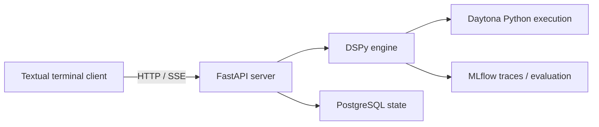

# Fleet RLM Lite architecture

Fleet RLM Lite connects a Python terminal client to a stateful reasoning service.
DSPy orchestrates model calls, Daytona executes generated Python, PostgreSQL
stores durable Session data, and MLflow records traces and evaluation evidence.
The implementation lives in `src/fleet_rlm/`; the
[source layout](docs/reference/source-layout.md) maps its modules.

## Request flow and ownership

`cli.py` provides the `fleet` entry point. `launcher.py` manages the local API and,
for the default tracking profile, local MLflow. The terminal client uses Textual
for interactive terminals and Rich for non-TTY input. It submits requests and
renders streamed events; execution belongs to the server.

The API owns request validation and SSE delivery. Ordinary routes run in
FastAPI's threadpool; the Turn stream is asynchronous. `session.py` manages the
runtime registry and per-Session ownership. A runtime combines a Daytona manager,
PostgreSQL harness, Skill manager, and DSPy engine. `engine/turn.py` runs the Turn
on a worker thread: claim, prepare inputs, execute, persist, and report.
See the [HTTP API](docs/reference/http-api.md) and [CLI](docs/reference/cli.md)
references for public interfaces.

Configuration is validated and frozen at process startup. Precedence is defaults,
TOML, `.env`, environment, then explicit overrides. `config/fleet.toml` uses schema
4; `FLEET_CONFIG` is selected through process environment. Credentials and database
DSNs stay in secret configuration sources. Persisted Session mode/model selections
remain overrides. `/config` exposes safe effective values, sources, and a digest;
the authenticated local setup API can stage and save supported `.env` overrides.
Applying them restarts owned services; runtime settings are never hot-reloaded.

MLflow has independent local and Databricks profiles selected by command before
backend validation. Tracking initialization must succeed before API readiness;
`/health` reports the destination so clients can reject incompatible server reuse.
See [configuration](docs/reference/configuration.md) for settings and authentication.

## Local onboarding

`fleet cli` starts the same FastAPI app in setup mode on a private loopback port
before acquiring runtime resources. Setup mode loads no Store, MLflow destination,
or Session registry. A random per-launch bearer token authorizes `/setup` routes;
ordinary API requests retain their existing trust boundary. The TUI performs all
readiness checks, configuration edits, and provider actions through these routes.
Secrets are masked and excluded from operation progress and validation responses.

Setup has an in-memory draft and explicit atomic `.env` save. Read-only probes
check Gateway discovery, database connectivity/schema version, the selected
tracking backend, and Daytona snapshot/Volume readiness. Builds, activation,
Volume creation, and the optional inference test run as serialized worker
operations with bounded reconnectable SSE progress. Disconnect does not replay
or cancel a provider mutation; uncertain outcomes require provider readback.

After readiness succeeds, the launcher stops the bootstrap process and starts
normal services with fresh frozen settings. A CLI-owned loopback runtime retains
the protected setup routes for `/setup`; apply fences new Turns and refuses to
restart while work is active. The launcher owns the actual restart and preserves
the Session ID. Reused and remote servers expose no client-managed setup actions.

## Durable state and workspace

The Store owns PostgreSQL access and numbered additive migrations, applied under
a transaction lock with the migration DSN when supplied. Durable data includes
Turn history, file content, reviewed memories, request intents/outcomes, Session
settings, and selected immutable replay snapshots. A dedicated PostgreSQL advisory
lock connection establishes runtime ownership. Eviction and closure fence stale
runtime references before releasing ownership; stored history cannot restore
live Python variables.

Daytona Volumes hold Session workspace paths such as `files`, `artifacts`,
`memory`, `skills`, `buffers`, and `sessions`. A successful Turn keeps its warm
root interpreter for subsequent Turns. Failure or cancellation discards the
stopped root; the next Turn cold-resumes durable state into a new sandbox.
See [database](docs/reference/database.md) for persistence details.

Each Turn synchronizes bundled Skills, then user Skills from `.fleet/skills/`,
to the Session workspace. User Skills override bundled names. Root and child
sandboxes discover instructions and resources through Skill helpers.
`.agents/skills/` contains developer guidance and is excluded from user Skill sync.
Root sandboxes can also mount shared learned notes at `/learned`. These redacted,
unreviewed summaries are hints to verify; they are separate from reviewed memories
and executable Skill content.

Dataset inputs use file-backed `WorkspaceDataset` handles with bounded metadata,
previews, and source digests. Metadata and revision checks compute size and hash
remotely. Native RLM reconstructs a view through `dspy.SandboxSerializable`; Flex
uses a `dspy.Type` wrapper to preserve that contract. The dataset stays in Daytona
rather than being eagerly loaded into the model context.

## Execution lifecycle and recovery

Each namespace is a stateful Daytona code-interpreter context. The synchronous
Fleet interpreter prepares workspace helpers once and issues one `run_code` per
execution. Bounded results and host-tool requests travel as stdout marker lines;
the host dispatches tools on separate threads and uploads reply files for the
sandbox to read. Credentials and host-mediated model clients remain on the server.

A transport failure makes execution outcome unknown. Fleet aborts the Turn and
stops the root without replaying code. Declared artifact verification also runs
once in Daytona; transport ambiguity cannot trigger a second verification run.

A Turn has one terminal outcome and one teardown owner. Failure, cancellation,
deadline expiry, or disconnect before a reported outcome sets cancellation,
fences outstanding host calls, shuts down children, and stops the root before
terminal acknowledgment and `done`. Cleanup records `stopped` or `unconfirmed`;
success records `not_required` and retains the warm root. Disconnect after a
reported outcome does not cancel the completed Turn.

Every bridged host call carries an execution identity. Cancellation or execution
end closes its reply fence; late successful replies are refused once with a
bounded warning and no retry. Cancellation and error replies remain deliverable.
This fence discards late results; it does not interrupt provider requests or
replace child shutdown.

The deadline is resolved once at Turn start: request `timeout_seconds`, then
configured `turn_timeout_seconds`, then the shipped 900-second default. Request
omission or `null` inherits; `0` disables Fleet's wall-clock deadline. Structured
inputs require integer `0` or `10`–`3600`; environment and dotenv sources also
accept numeric text. `/timeout` is client-local state sent as a request override.

Bounded Turns propagate an absolute monotonic deadline through child contexts;
children cannot extend it. Watchdogs are generation-bound and serialized with
Turn end/reset so stale callbacks cannot stop a later Turn or a warm root.
Deadline-free Turns arm no watchdog and explicitly use `run_code(timeout=0)`.
Daytona's provider-owned TTL and auto-stop bounds still apply.

The repository defines the Turn snapshot in
[`sandbox/snapshots/definition.py`](src/fleet_rlm/sandbox/snapshots/definition.py). Preflight requires an
active snapshot meeting resource floors, then records provider-resolved identity,
resources, and definition digest on the trace, stored Turn, and new replay.
Missing optional packages are observations. Historical records without provenance
remain readable as `pre-provenance`.

## Reasoning and delegation

The route vocabulary is `direct` / `flex` / `rlm`. Strict modes bypass triage;
hybrid uses TypeSafe Jev when configured and generative routing otherwise, falling
back to RLM on routing errors or unknown labels. Selected datasets cannot take a
context-free direct route. RLM exposes instruction tuning; Flex exposes native
module-source rewriting and initially wraps an RLM when given tools. Both routes
can delegate.

After routing, optional Jev Skill selection preloads up to three relevant
instructions for non-direct tasks. Decisions consume shared budget; ordinary
selection failures retain the catalog. DSPy model/adapter overrides use scoped
`dspy.context`; pinned facade, callback, usage, and GEPA integration points need
contract validation on upgrades.

Explicit `spawn_agent` accepts a subtask and selected input paths; `spawn_agents`
runs independent children concurrently within active capacity. Explicit children
always receive Skills; other inputs are copied only when selected, with none by
default. Their only optional Fleet tool is further `spawn_agent` delegation.
Native nested RLMs copy their parent's `files/` and `skills/`. All use distinct
Volume subpaths and promote staged outputs only after successful completion;
unchanged copied artifacts are not promoted as new outputs. `spawn_agents` returns
bounded per-child errors for ordinary failures, while deadline, cancellation, and
shared-budget exhaustion abort the Turn. Depth, total/active children, shared
budget, and deadlines are host-enforced. Tool restrictions limit delegation;
Daytona policy governs generated Python and network access.

Deletion waits for provider confirmation. Ambiguous creation is not blindly
retried; local allocation journals support later reconciliation, with provider
TTL covering loss of local journals. See the
[delegation Skill](src/fleet_rlm/bundled_skills/delegation/SKILL.md) for usage.

## Observability and evaluation

MLflow records Turn, model, execution, preparation, transfer, persistence, and
cleanup evidence with bounded redaction. Each `sandbox.exec` span covers one
execution through result interpretation; Python errors remain visible even if
DSPy recovers. Native usage scopes avoid double-counting nested calls. Missing
usage or monetary cost remains unknown.

`lm_calls` counts shared budget units, including generation, routing, and Skill
decisions. `sandbox_errors` and `submit_rejections` remain separate counters.
Host-collected `artifact_changes` distinguishes created, modified, retained,
deleted, and unknown content; the public `artifacts` list is the Session inventory.
Skill receipts show helper activity without proving script success or compliance.
Numeric submission checks are heuristic evidence checks, not correctness proofs.

Progress labels such as `waiting_on_host`, `progressing`, `stalled`,
`progress_unknown`, `interrupted`, and `fenced` are advisory. Explicit progress
scopes and increasing checkpoints support observation; uninstrumented work stays
unknown. Worker ingestion and SSE sampling are synchronized. Under backpressure,
progress may be coalesced or dropped; pending progress is discarded after an
outcome and `done` remains the final event. Labels never control execution.

`fleet_metric` is shared by evaluation and GEPA, returning score, feedback, and
objective scores. A separate judge LM assesses correctness; the reflection LM
serves GEPA proposal/reflection. MLflow judge URIs and DSPy model IDs use distinct
configuration helpers. Route-suitability assessments identify Jev or generative
backends; other diagnostic scorers do not automatically become GEPA objectives.

Optimization uses approved immutable replays grouped by source lineage. Fresh,
isolated runtimes restore captured inputs and Skill revisions using current
deployment configuration and credentials. Gold answers and structured artifact
or delegation expectations stay outside program inputs. Host receipts support
those checks; declared Python verifiers execute in Daytona.

GEPA searches train/dev, then evaluates holdout through paired validation against
the incumbent. Correctness, critical holdout cases, execution errors, and measured
usage gate promotion. Candidate artifacts and manifests remain separate from active
pointers; approval rechecks artifact, incumbent, configuration, code, and dependency
identities. Incompatible evidence requires reevaluation. External benchmark datasets
and official verifiers belong to notebooks/helpers; benchmark traces are excluded
from curated optimization data. See [evaluation](docs/reference/evaluation.md) and
the [canary runbook](docs/runbooks/evaluation-canary.md) for policy and procedures.

## Trust boundaries

The API has no built-in caller authentication and defaults to `127.0.0.1`.
Non-loopback binding requires `FLEET_ALLOW_NON_LOOPBACK_BIND=true` and a separately
secured deployment boundary. Generated Python executes in Daytona under provider
policy. Local tests cannot establish provider availability, isolation policy,
model compatibility, or workload improvement. Live validation requires explicit
authorization, suitable resources, and saved execution evidence.
