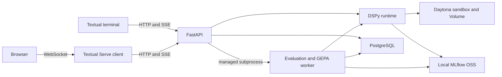

# Fleet RLM Lite architecture

Fleet's Textual clients send HTTP requests to a FastAPI service and receive Turn
events over SSE. DSPy selects and executes the reasoning program, Daytona runs
generated Python, PostgreSQL holds durable state, and local MLflow OSS records
traces and evaluation runs.

## Process ownership and trust

- `fleet cli` and `fleet web` share the launcher. It can start local MLflow and
  FastAPI or reuse compatible services. An explicit `--url` validates the API's
  readiness and runtime identity without loading backend settings or starting
  services. Textual Serve starts an isolated client subprocess per connection.
- FastAPI owns the Store, Session registry, Turn executor, and managed experiment
  worker. Shutdown joins the worker and flushes traces before the launcher stops
  its MLflow server. The API and worker coordinate ownership through PostgreSQL.
- The API binds to loopback by default and has no ordinary caller authentication.
  External exposure requires opt-in and a secured boundary. Browser WebSockets
  validate Origin and Host. External browser listeners also require a bearer
  secret provided by an authenticated TLS reverse proxy.
- Model credentials and host-mediated tools stay on the server. Generated Python
  runs in Daytona under its provider policy. Host calls use bounded requests and
  replies, and guest codec reconstruction stays inside Daytona.

See [configuration](docs/reference/configuration.md), the [CLI
reference](docs/reference/cli.md), and the [source layout](docs/reference/source-layout.md).

## Session state and workspace

The Session registry owns admission and lifecycle for each live runtime. Store
owns transactions and additive schema migrations. A PostgreSQL lease and epoch
fence stale owners, and batched heartbeats renew live leases. Durable history,
settings, memories, files, and selected replays survive process restart. Live
Python variables survive only while the interpreter remains available.

Daytona Volumes hold workspace files. Set the lease-fenced workspace state to
`unknown` before mutating a Volume so later Turns prepare against the real
workspace. A new, `known_empty` Session can preview Hybrid routing locally and
answer Direct without provisioning Daytona. Selected Direct replays retain the
staged local Skill files. Use a new Volume with a new database schema so an
apparently new Session cannot silently overlook a pre-existing workspace.

Bundled Skill names are reserved. Conflicting local or Volume copies are ignored
with a warning. User Skills live in `.fleet/skills/`, and developer guidance in
`.agents/skills/` stays on the host. Selected datasets are file-backed handles
and use DSPy's sandbox serialization.

See [database](docs/reference/database.md) and the [sandbox
environment](docs/reference/sandbox-environment.md).

## Turn execution and failure

1. FastAPI admits a Turn and serializes work for its Session. Turn preparation
   loads durable context, resolves Skill admission, and inspects the workspace
   where required.
2. The DSPy graph owns routing, Skill selection, reasoning, and learned child
   policies. Strict modes bypass triage. Hybrid selects Direct, Flex, or RLM.
   Dataset and required-Skill admission constrain routing. Serving and isolated
   rollouts share invocation and host evidence collection.
3. The sandbox manager owns the budget, Turn generation, interpreter, and child
   lifecycle. Nested execution shares deadlines and budget. Children use isolated
   sandboxes and promote artifacts only after successful execution. Ambiguous
   remote execution aborts the Turn without replaying the code.
4. On success, the Session commits the canonical result with host receipts and
   retains the warm root. On failure, cancellation, expiry, or disconnect before
   commit, the teardown owner fences host replies, interrupts the root, and
   attempts all required child cleanup before acknowledgment. Unconfirmed
   cleanup retains allocation identity and fences writable reuse. Disconnect and
   commit are serialized so a durably completed result can still be recovered.

SSE progress is best effort. Terminal outcomes and their durable readback use
the same result, and `done` ends the stream. MLflow records bounded, redacted
evidence and separates model usage, Python errors, and submission rejections.

See the [HTTP API](docs/reference/http-api.md), [Turn
results](docs/reference/turn-results.md), and [delegation
Skill](src/fleet_rlm/bundled_skills/delegation/SKILL.md).

## Evaluation, workers, and program approval

PostgreSQL holds the shared ledger for managed `optimize`, `evaluate_rescore`,
and `evaluate_replay` jobs. FastAPI owns admission, cancellation intent,
abandoned-owner recovery, and post-exit terminal arbitration. The worker owns
running stages and counters. The API drains worker output to a bounded private
log. Required persistence failures stop search and block publication. Optional
MLflow telemetry is best effort. A standalone `fleet eval run` collects
synthetic examples through the API.

Optimization uses approved immutable replays in isolated runtimes. It groups
examples by source lineage, keeps gold outside program inputs, excludes
benchmarks from curation, and keeps holdout out of search. Native GEPA can be
followed by ReAnchor calibration. Paired validation, critical holdout,
correctness, and measured usage gate candidate promotion.

Candidate creation and installation are separate. Approval verifies the
artifact, incumbent, configuration, code, and dependencies. The ledger and
installed `fleet.json` must agree. The serving runtime checks that identity at
Session construction and each Turn. An absent file permits baseline only when
the ledger has no approved global program. Legacy artifacts remain inspectable.

See the [evaluation reference](docs/reference/evaluation.md) and [evaluation
canary](docs/runbooks/evaluation-canary.md).
