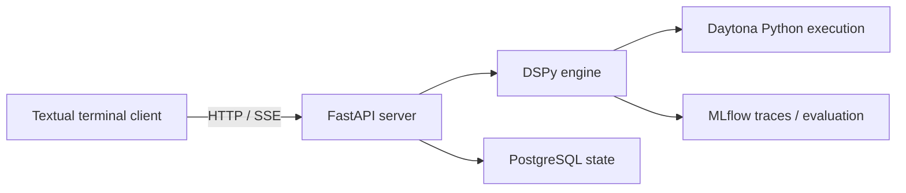

# Fleet RLM Lite architecture

Fleet connects a Python terminal client to a stateful reasoning service.

- DSPy orchestrates model calls.
- Daytona executes generated Python.
- PostgreSQL stores durable Session state.
- MLflow records traces and evaluation evidence.

Code lives in `src/fleet_rlm/`. See the [source layout](docs/reference/source-layout.md).

## Request flow and ownership

- FastAPI (`fleet_rlm.api.app`) is the primary application; `cli.py` provides the
  `fleet` entry point, where `serve` starts the API and `optimize`/`eval` are offline tooling.
- `launcher.py` owns the local API and optional local MLflow.
- Textual/Rich clients submit requests and render events.
- FastAPI validates requests and streams SSE. Ordinary routes use its threadpool.
- `session.py` owns the runtime registry and Session leases.
- `engine/turn.py` runs each Turn on a worker thread; `sandbox_mgr.turn_scope()` is the one
  place that decides whether a caller owns a Turn, so a program nested inside an API Turn
  never resets its budget or tears it down.
- Each runtime combines a Daytona manager, PostgreSQL harness, Skill manager, and DSPy engine.
- The runtime does not import the offline optimizer: shared route, input, and evidence
  contracts live in neutral modules (`contracts`, `program_file`, `execution_evidence`).

See [HTTP API](docs/reference/http-api.md) and [CLI](docs/reference/cli.md).

## Configuration and setup

- Settings are validated and frozen at startup.
- Precedence: defaults → TOML → `.env` → environment → explicit overrides.
- Persisted Session mode/model choices remain overrides.
- `/config` exposes safe values, sources, and a digest.
- The selected local or Databricks MLflow profile initializes before API readiness.
- `/health` identifies the tracking destination to prevent incompatible reuse.

Local setup:

- `fleet cli` starts a private loopback setup API before opening runtime resources.
- A per-launch bearer token protects setup routes.
- The TUI stages edits, saves `.env` atomically, and probes readiness.
- Provider operations run serially with bounded, reconnectable progress.
- Secrets are masked. Ambiguous provider outcomes require readback before retrying.
- Apply fences new Turns and refuses to restart while work is active.
- The launcher restarts owned services with fresh settings and preserves the Session ID.
- Reused and remote servers expose no client-managed setup actions.

See [configuration](docs/reference/configuration.md) and [setup API](docs/reference/http-api.md#private-local-setup-api).

## Durable state and workspace

- The Store owns PostgreSQL access and locked additive migrations.
- Durable data includes Turn history, files, reviewed memories, request outcomes, settings, and selected immutable replays.
- A dedicated advisory-lock connection owns each runtime.
- Eviction fences stale runtime references before releasing ownership.
- Stored history cannot restore live Python variables.
- Daytona Volumes hold Session workspaces.
- Successful Turns preserve the warm root interpreter.
- Failed or cancelled Turns discard it. The next Turn cold-resumes durable state.

Workspace inputs:

- Each Turn syncs bundled Skills, then user Skills from `.fleet/skills/`.
- User Skills override bundled names. `.agents/skills/` is excluded from sync.
- Optional `/learned` notes are unreviewed hints, separate from memories and executable Skills.
- Datasets stay in Daytona as file-backed `WorkspaceDataset` handles.
- Handles expose bounded previews and digests through the DSPy sandbox serialization contract.

See [database](docs/reference/database.md).

## Execution and Turn lifecycle

1. Claim the Session for the Turn.
2. Prepare inputs and the sandbox.
3. Execute the DSPy program on the worker thread.
4. Persist the outcome and durable state.
5. Report the outcome and finish the stream.

Execution boundaries:

- Each namespace is a stateful Daytona interpreter.
- Each execution makes one `run_code` call.
- Stdout markers carry bounded results and host-tool requests.
- Host threads dispatch tools and return reply files.
- Credentials and host-mediated model clients stay on the server.
- Transport ambiguity aborts the Turn and stops the root.
- Ambiguous execution never replays code or artifact verification.
- [Snapshot preflight](docs/reference/sandbox-environment.md) enforces resource floors and records provider-resolved identity.
- Missing optional packages are observations. Historical records remain readable as `pre-provenance`.

Outcomes and cleanup:

- Each Turn has one terminal outcome and one teardown owner.
- Failure, cancellation, expiry, or disconnect before a reported outcome triggers teardown.
- Teardown cancels and fences host work, shuts down children, and stops the root before acknowledgment and `done`.
- Cleanup records `stopped` or `unconfirmed`. Success records `not_required` and keeps the warm root.
- Reply fences refuse late successful results once, without retry.
- Error and cancellation replies remain deliverable.
- Fencing does not interrupt provider calls or replace child shutdown.
- Watchdogs bind to Turn generations and serialize with Turn end/reset.

Deadlines:

- Request timeout overrides configuration. The default is 900 seconds.
- Exactly `0` disables only Fleet's deadline.
- `/timeout` is client-local request state.
- Children inherit the parent's deadline.
- Daytona TTL and auto-stop bounds still apply.

## Reasoning and delegation

- Routes are `direct`, `flex`, and `rlm`.
- Strict modes bypass triage.
- Hybrid uses Jev when configured, otherwise generative routing.
- Routing errors or unknown labels fall back to RLM.
- Selected datasets cannot use context-free direct answers.
- RLM tunes instructions. Flex rewrites module source and initially wraps RLM when given tools.
- Both execution routes carry the Turn's RLM budgets: the Flex source is rewritten so its
  inner `dspy.RLM` gets the same iteration and call caps as the primary RLM.
- Both RLM and Flex can delegate.
- Optional Jev Skill selection preloads up to three instructions and consumes shared budget.
- Ordinary Skill selection failures retain the catalog.
- DSPy overrides use scoped `dspy.context`. Pinned bridges need upgrade validation.

Child execution:

- Explicit children receive Skills plus selected inputs.
- Native nested RLMs copy their parent's `files/` and `skills/`.
- Children use isolated Volume paths and promote only successful changed outputs.
- The host enforces shared budgets, depth, capacity, and deadlines.
- Batch ordinary failures return per-child errors.
- Cancellation, deadline expiry, and shared-budget exhaustion abort the Turn.
- Provider deletion requires confirmation.
- Ambiguous creation uses allocation journals and reconciliation.

See the [delegation Skill](src/fleet_rlm/bundled_skills/delegation/SKILL.md).

## Observability

- MLflow records bounded, redacted execution evidence.
- Recovered Python errors remain visible.
- Nested usage is not double-counted. Missing usage or cost stays unknown.
- `lm_calls` counts shared budget units.
- Execution errors and submission rejections have separate counters.
- Host receipts distinguish artifact changes from the Session inventory.
- Skill activity and numeric evidence checks do not prove correctness.

Progress events:

- Labels are advisory and never control execution.
- Uninstrumented work stays `progress_unknown`.
- Worker ingestion and SSE sampling are synchronized.
- Backpressure may drop progress events.
- Pending progress is discarded after an outcome. `done` remains last.

## Evaluation

- Evaluation and GEPA share `fleet_metric`.
- Serving, correctness judging, and reflection use separate roles.
- Route assessments identify Jev or generative backends.
- Diagnostic scorers do not automatically become GEPA objectives.
- Search uses approved immutable replays grouped by lineage in isolated runtimes.
- Gold stays outside program inputs. Host receipts support artifact and delegation scoring.
- Train/dev search excludes holdout.
- Paired validation, critical cases, correctness, execution errors, and measured usage gate promotion.
- Candidate creation and installation are separate.
- Approval rechecks artifact, incumbent, configuration, code, and dependency identities.
- Installed distribution identities, rather than source-tree lockfile paths, identify dependencies.
- Incompatible evidence requires reevaluation.
- External benchmarks and verifiers live in notebooks/helpers.
- Benchmark traces stay outside curation.

See [evaluation](docs/reference/evaluation.md) and the [canary runbook](docs/runbooks/evaluation-canary.md).

## Trust boundaries

- The ordinary API has no caller authentication and defaults to `127.0.0.1`.
- Non-loopback binding requires `FLEET_ALLOW_NON_LOOPBACK_BIND=true` and a secured boundary.
- Daytona policy governs generated Python and network access.
- Live validation requires explicit authorization and saved evidence.
- Offline tests cannot establish provider availability, isolation, model compatibility, or workload improvement.
