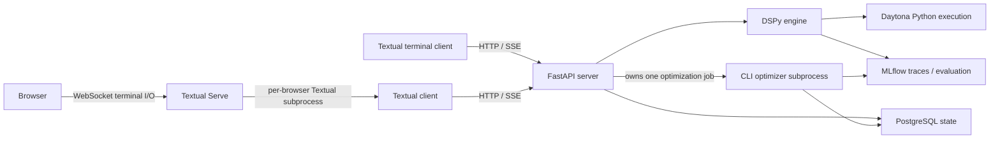

# Fleet RLM Lite architecture

Fleet connects a Python terminal client to a stateful reasoning service.

- DSPy orchestrates model calls.
- Daytona executes generated Python.
- PostgreSQL stores durable Session state.
- MLflow records traces and evaluation evidence.

Code lives in `src/fleet_rlm/`. See the [source layout](docs/reference/source-layout.md).

## Request flow and ownership

- FastAPI (`fleet_rlm.api.app`) is the primary single-mode application; `cli.py` provides the
  `fleet` entry point, where `serve` starts the API, `web` serves the Textual client,
  `doctor` validates Models/Database/MLflow/Daytona configuration read-only, `snapshot`
  manages Daytona execution snapshots, `optimize` runs standalone GEPA/eval workflows,
  `eval` manages datasets/labels/scoring, and `trace` verifies recorded traces.
- `launcher.py` owns the local API and optional local MLflow.
- Textual/Rich clients submit requests and render events. `fleet web` serves the same Textual client through Textual Serve; each browser connection runs an isolated client subprocess against the API.
- FastAPI validates requests and streams SSE. Ordinary routes use its threadpool.
- The API owns TUI optimization jobs (`/improve/jobs`, one `kind` ledger shared by future evaluate kinds) through one subprocess slot; labels are managed globally but stay attached to their source Turns, while jobs and the installed program belong to no Session. The worker runs the existing CLI optimizer and is the sole durable writer of running stages and progress counters for managed and standalone runs. PostgreSQL owns lifecycle state; local manifests/reports hold required candidate evidence, while MLflow tracking is best effort. The API does not import GEPA.
- The API drains both worker pipes without interpreting progress. Managed workers persist an outcome handoff; the API confirms exit and pipe draining before owner/status-fenced terminal arbitration. Admission, cancellation intent and owner recovery remain API responsibilities.
- A disconnected client does not cancel its experiment. Explicit cancellation is cooperative. The launcher drains API-owned experiments before stopping services; an API restart fences abandoned work as interrupted and never reruns it.
- A dedicated PostgreSQL owner lease distinguishes live APIs from abandoned owners, including before worker startup. Orphaned running rows are reconciled under the global optimization lease by both the API and standalone optimizer. Polled status reads reconcile at most once per interval, while startup, admission, review, and shutdown drain reconcile immediately.
- `session.py` owns the runtime registry and Session leases.
- `engine/turn.py` runs each Turn on a worker thread; `sandbox_mgr.turn_scope()` is the one
  place that decides whether a caller owns a Turn, so a program nested inside an API Turn
  never resets its budget or tears it down.
- Each runtime combines a Daytona manager, shared Store reference, Skill manager, and DSPy engine.
  `SessionRuntime` owns memory, history, idempotency, and Turn-record policies; Store owns SQL and transactions.
- The runtime does not import the offline optimizer: shared route, input, and evidence
  contracts live in neutral modules (`contracts`, `execution_evidence`).
- `engine/programs.py` owns `FleetProgram(dspy.Module)`: Routing, Skill selection,
  Reasoning and Child policies own the native learned graph. They do not own Store,
  compiled-file selection or Turn finalization.
- `engine/invocation.py` constructs that graph with host capabilities and shares
  dataset admission, native invocation, callbacks and authoritative evidence between
  serving and freshly reconstructed isolated rollouts. Outer Turn/Session owners
  retain persistence, cancellation arbitration and teardown.
- `engine/compiled.py` accepts only complete `fleet-program-b2` envelopes. Legacy
  native JSON and `fleet-program-b1` envelopes remain inspectable, not installable;
  there is no old-root alias or key conversion. There is one global installed
  program, `fleet.json`; an absent file means baseline only while no global job
  was ever approved. The ledger (`Store.approved_program`) is checked at runtime
  creation and every Turn, so a missing or changed file refuses execution regardless
  of process age; an invalid file refuses too. Every Session picks up an approval
  at its next Turn.

See [HTTP API](docs/reference/http-api.md) and [CLI](docs/reference/cli.md).

## Configuration and setup

- Settings are validated and frozen at startup.
- Precedence: defaults → TOML → `.env` → environment → explicit overrides.
- Persisted Session mode/model choices remain overrides.
- `/config` exposes safe values, sources, and a digest.
- The selected local or Databricks MLflow profile initializes before API readiness.
- `/health` identifies the tracking destination to prevent incompatible reuse.
- Adapters default to `XMLAdapter` (`adapter = "xml"`, with native function calling) across all roles, with optional `"chat"` (`ChatAdapter`) and `"json"` (`JSONAdapter`).
- `model_type` defaults to `"auto"` across all roles, automatically routing custom OpenAI-compatible gateways to `"chat"`.

Local readiness and snapshots:

- `fleet doctor` (`doctor.py`) validates configured model routes, PostgreSQL/Lakebase
  connections and schema version, MLflow destination, and Daytona snapshot readiness in
  read-only checks (adding `--probe-models` only when an explicit inference probe is
  requested).
- `fleet snapshot preflight|build|activate` manages Daytona's execution snapshot
  through `sandbox/snapshots.py`.
- `fleet cli` and `fleet web` open the ordinary FastAPI server directly without a
  separate setup-mode server; configuration and `.env` / `config/fleet.toml` edits
  remain operator-managed on the host and apply on restart.

See [configuration](docs/reference/configuration.md) and [CLI](docs/reference/cli.md).

## Durable state and workspace

- The Store owns PostgreSQL access and locked additive migrations.
- Durable data includes Turn history, files, reviewed memories, request outcomes, settings, and selected immutable replays.
- A dedicated advisory-lock connection owns each runtime.
- Eviction fences stale runtime references before releasing ownership.
- Stored history cannot restore live Python variables.
- Daytona Volumes hold Session workspaces.
- Successful Turns preserve the warm root interpreter.
- Failed or cancelled Turns stop it. Confirmed cleanup permits the next Turn to
  cold-resume durable state; unconfirmed cleanup retains resource identity and
  denies writable reuse in the live process.

Workspace inputs:

- Each Turn syncs bundled Skills, then user Skills from `.fleet/skills/`.
- User Skills override bundled names. `.agents/skills/` is excluded from sync.
- Optional `/learned` files are written for human review and are not separately read into Turn prompts; their notes may also be persisted as Session memories, separate from executable Skills.
- Datasets stay in Daytona as file-backed `WorkspaceDataset` handles.
- Handles expose bounded previews and digests through the DSPy sandbox serialization contract.
- Initial `known_empty` workspace state is recorded under the Session advisory lease and
  refreshed after lease acquisition. While `known_empty`, Hybrid previews the route with
  the locally staged Skill manifest/catalog; a `Direct` result reuses local history/memory
  and captures local Skill files in selected replays without starting Daytona (leaving Turn
  snapshot `provenance_state` `"unresolved"` because no sandbox ran). Dataset-backed,
  required-Skill, existing, or uncertain Sessions still prepare fully.
- Workspace writes, attachment uploads, deletions, Skill sync, and execution Turns invalidate
  `known_empty` to `unknown` before mutating the non-transactional Daytona Volume.
- A new Session row is marked `known_empty` from the database insert alone. That does not
  list the Daytona Volume. A new database schema must not reuse a Volume that already holds
  Session subtrees; a sandbox-free Direct turn would miss those files. Keep the previous
  database with that Volume, or do not point the new schema at it.

See [database](docs/reference/database.md).

## Execution and Turn lifecycle

1. Claim the Session for the Turn.
2. Prepare inputs and the sandbox.
3. Execute the DSPy program on the worker thread.
4. Persist the outcome and durable state.
5. Report the outcome and finish the stream.

Execution boundaries:

- Each namespace is a stateful Daytona interpreter.
- Each execution makes one `run_code` call.
- Stdout markers carry bounded results and host-tool requests.
- Host threads dispatch tools and return reply files.
- Credentials and host-mediated model clients stay on the server.
- Transport ambiguity aborts the Turn and stops the root.
- Ambiguous execution never replays code or artifact verification.
- [Snapshot preflight](docs/reference/sandbox-environment.md) enforces resource floors and records provider-resolved identity.
- Missing optional packages are observations. Historical records remain readable as `pre-provenance`.

Outcomes and cleanup:

- Each Turn has one terminal outcome and one teardown owner.
- Failure, cancellation, or expiry triggers teardown; disconnect cancellation is serialized
  with commit and preserves a durably completed outcome even before delivery.
- Teardown cancels and fences host work, interrupts the root before child deletion,
  and attempts all required cleanup before acknowledgment and `done`.
- Cleanup records `stopped` or `unconfirmed`. Success records `not_required` and keeps the warm root.
- Unconfirmed cleanup retains root/allocation identity and fences provisioning and
  workspace access across Turn resets. Registry eviction retains the fenced runtime
  and its lease until a later shutdown confirms cleanup. This in-memory guard does
  not establish safety after process restart; see the
  [F0 acceptance report](docs/archive/fleet-rlm-prds/F0-acceptance.md).
- Reply fences refuse late successful results once, without retry.
- Error and cancellation replies remain deliverable.
- Fencing does not interrupt provider calls or replace child shutdown.
- Watchdogs bind to Turn generations and serialize with Turn end/reset.
- Successful commit ends the execution deadline before optional observation and delivery.
  Session assembles one [canonical result](docs/reference/turn-results.md) for Store, live SSE and reconnect.

Deadlines:

- Request timeout overrides configuration. The default is 900 seconds.
- Exactly `0` disables only Fleet's deadline.
- `/timeout` is client-local request state.
- Children inherit the parent's deadline.
- Daytona TTL and auto-stop bounds still apply.

## Reasoning and delegation

- Routes are `direct`, `flex`, and `rlm`.
- Strict modes bypass triage.
- Hybrid uses Jev when configured, otherwise generative routing.
- Automatic Hybrid uses a 3-way `Choice` across `direct`, `flex`, and `rlm`:
  `direct` for self-contained responses requiring no code, files, or Skills;
  `flex` for one bounded calculation, structured file/table inspection, or single-pass workflow with known inputs and verifiable outputs;
  `rlm` for multi-step iterative investigation, open-ended discovery, progressive Skill workflows, or multi-agent decomposition.
- Routing errors or unknown labels fall back to RLM.
- Selected datasets cannot use context-free direct answers.
- RLM tunes instructions and supports multi-turn `dspy.History`. Flex rewrites module source and wraps RLM when given tools.
- Both execution routes share the host-enforced Turn budget. RLMs authored inside Flex
  retain native DSPy constructor defaults (`max_iters=20`, `max_llm_calls=50`) unless
  explicitly set; Fleet does not patch constructors or rewrite generated source.
- Native guest RLM executes inside Daytona with preloaded DSPy (`dspy.primitives.sandbox_guest`)
  and native wire serialization. Host dataset codecs create file-backed `WorkspaceDatasetView`
  handles; forwarded views carry only JSON metadata. Guest codec reconstruction never runs on the host.
  `workspace.load_image` supplies native DSPy images.
- Both RLM and Flex can delegate.
- Optional Jev Skill selection preloads up to three instructions using `Noul` relevance and consumes shared budget.
- Ordinary Skill selection failures retain the catalog.
- DSPy overrides use scoped `dspy.context`. Pinned bridges need upgrade validation.

Child execution:

- Native `llm_query` / `llm_query_batched` are semantic model queries, not full child agents.
- Explicit children execute fresh native `dspy.RLM(ChildTask, ...)` instances on the metered sub LM.
  Fleet retains selected inputs, allowlisted tools, bounded slices, concurrent context propagation,
  failure classification, success-only promotion, and cleanup.
- The root owns `child_policies.leaf_action` and `child_policies.delegating_action` as native DSPy predictors.
  Each invocation copies its role's learned instructions/demos into a fresh child action predictor;
  tools, resource limits, interpreter, and metered LM remain runtime-owned. Distinct signature
  field descriptions preserve native GEPA attribution even with identical learned instructions.
  Child extraction and arbitrary RLMs constructed by Flex are not separately tuned policies.
- `sandbox/delegation.py` owns allocation/execution and accepts copied policy state,
  not a program reference. It has no dependency on the engine's learned modules.
- Explicit children receive Skills plus selected inputs.
- Native nested RLMs copy their parent's `files/` and `skills/`.
- Children use isolated Volume paths and promote only successful changed outputs.
- The host enforces shared budgets, depth, capacity, and deadlines.
- Batch ordinary failures return per-child errors.
- Cancellation, deadline expiry, and shared-budget exhaustion abort the Turn.
- Provider deletion requires confirmation.
- Ambiguous creation uses allocation journals and reconciliation.

See the [delegation Skill](src/fleet_rlm/bundled_skills/delegation/SKILL.md).

## Observability

- MLflow records bounded, redacted execution evidence.
- Recovered Python errors remain visible.
- Nested usage is not double-counted. Missing usage or cost stays unknown.
- `lm_calls` counts shared budget units.
- Execution errors and submission rejections have separate counters.
- Host receipts distinguish artifact changes from the Session inventory.
- Skill activity and numeric evidence checks do not prove correctness.
- Optional `FLEET_MLFLOW_BENCHMARK_MODEL_ID` and `FLEET_MLFLOW_BENCHMARK_TAGS` associate benchmark traces while retaining automatic `fleet.agent.model_id` on the root span.

Progress events:

- Labels are advisory and never control execution.
- Uninstrumented work stays `progress_unknown`.
- Worker ingestion and SSE sampling are synchronized.
- Backpressure may drop progress events.
- Pending progress is discarded after an outcome. `done` remains last.

## Evaluation

- Evaluation and GEPA share `fleet_metric`.
- Serving, correctness judging, and reflection use separate roles; `[llm.judge]` inherits base `[llm]` credentials when omitted.
- Route assessments identify Jev or generative backends.
- Diagnostic scorers do not automatically become GEPA objectives; execution-evidence diagnostics (`execution-evidence-v3`) can run out-of-band via `fleet eval score` without blocking online Turn tracing.
- Two-stage optimization runs native GEPA search followed by ReAnchor calibration:
  Stage 1 searches instruction candidates and Flex code via `dspy.GEPA`.
  Stage 2 executes native `dspy.experimental.ReAnchor` when a decision LM is configured,
  fitting triage `Choice` weights and Skill `Noul` thresholds on training examples only.
  Changed calibrated state is adopted when validation does not regress, before paired validation
  and holdout gates (`fleet-program-b2`, approval evidence version 3).
- Search uses approved immutable replays grouped by lineage in isolated runtimes.
  Nonempty train/dev/holdout splits and critical holdout are required before native search.
- Gold stays outside program inputs. Host receipts support artifact and delegation scoring.
- Train/dev search excludes holdout.
- Paired validation, critical cases, correctness, execution errors, and measured usage gate promotion.
- Candidate creation and installation are separate.
- Required worker persistence failures latch a native GEPA stop request and block validation, publication and successful finalization at explicit boundaries. Partial callbacks and stage changes preserve known counters. Database and file cancellation checks both remain active; provider calls stop cooperatively at native safe points. Optional tracking/diagnostic failures do not acquire control over run success.
- Approval rechecks artifact, incumbent, configuration, code, and dependency identities.
- Installed distribution identities, rather than source-tree lockfile paths, identify dependencies.
- Incompatible evidence requires reevaluation.
- External benchmarks and verifiers live in notebooks/helpers.
- Benchmark traces stay outside curation.

See [evaluation](docs/reference/evaluation.md) and the [canary runbook](docs/runbooks/evaluation-canary.md).

## Trust boundaries

- The ordinary API has no caller authentication and defaults to `127.0.0.1`.
- Non-loopback binding requires `FLEET_ALLOW_NON_LOOPBACK_BIND=true` and a secured boundary.
- Browser terminal WebSockets validate Origin and Host against the configured public URL before acceptance or client process creation.
- Non-loopback browser terminal listeners also require an environment-only bearer secret supplied by an authenticated TLS reverse proxy.
- Daytona policy governs generated Python and network access.
- Live validation requires explicit authorization and saved evidence.
- Offline tests cannot establish provider availability, isolation, model compatibility, or workload improvement.
