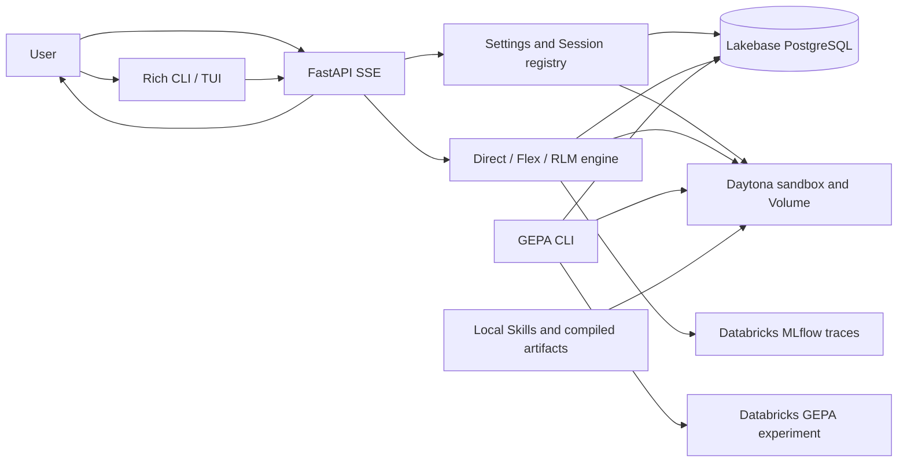

# Fleet RLM: Codebase Audit and Databricks Alignment

**Status:** Implementation and bounded acceptance partially complete; remaining live checks are recorded in P5.5

**Baseline commit:** `66ba7bfd83a431a5a5e0a656eb7be9e3f690f119`

**Working tree:** Existing staged, unstaged, and untracked changes are part of this audit baseline and must be preserved.

## Objective and agreed direction

Understand Fleet RLM end to end, identify evidence-backed cleanup, and implement supported improvements for reliable daily use.

The target remains a local CLI/API with Daytona execution. Databricks is the default for models, MLflow, and Lakebase. Genie supports developer discovery. Workloads are mixed, with priority on source-backed file and document analysis. Train GEPA on approved selected replays and retain bounded, redacted traces plus immutable replay evidence.

## Current GEPA contract

The audit entries below preserve the implementation and live-evidence record as it stood when each item was completed. They are historical where they describe the original instruction-only pilot, its frozen Flex proposer, or its acceptance criteria. Current GEPA uses DSPy's built-in code proposer and deployment settings, including persisted Session overrides; the manifest captures effective model configuration as provenance only. Search is limited to train/dev, and holdout runs only after search. Validation uses three paired passes. Quality is the minimum of judge correctness/safety, gold expected values, gold route, and applicable structured artifact/delegation checks; composite score is zero when quality is below 1, otherwise `0.9 + 0.1 * efficiency`. Critical cases require quality 1 in every pass. Promotion requires no aggregate quality regression on dev/holdout, improved dev composite score, no holdout composite regression, zero holdout execution errors, and measured usage. Approval rechecks the incumbent, configuration, code, and dependency identities; older manifests require reevaluation.

Current live verification uses `scripts/verify_runtime_live.py` for runtime acceptance and `scripts/verify_gepa_live.py` for the native GEPA canary. Selected replay examples need approved gold labels; partial label updates preserve existing expectations. Optimization and compilation do not automatically score historical traces. The standalone `auto_evaluate_traces` operation remains available for explicit evaluation.

The numbered additive Store migrations described in `docs/reference/database.md` are current behavior and use the migration DSN when configured.

Use the existing `projects/fleet-rlm/branches/production` Lakebase branch and endpoint for a fresh application database. Preserve Daytona isolation, the Turn deadline policy, and unknown-outcome no-replay behavior. Estimate paid validation cost before running provider or sandbox acceptance tests; agree a cap first. Coordinate compatibility changes across the bundled clients.

## Phase 0 — Establish the audit baseline

**Dependency:** None.

- [x] **P0.1 — Save this plan** at `docs/plans/fleet-rlm-audit-and-platform-alignment.md`.
- [x] **P0.2 — Capture the working-tree baseline.** HEAD and the 34 pre-existing modified tracked paths were recorded before audit edits. No staged or untracked paths were present. The working diff itself was not archived; preserve the user's current edits in place.
- [x] **P0.3 — Establish verification status.** Final local `make check` passed for the current checkout (404 tests plus Ruff, formatting, type checking, docs, OpenAPI, and build). The 34 initial edits were not snapshotted, so a separate pre-change gate could not be reconstructed without risking those edits.
- [x] **P0.4 — Maintain an evidence register.** Record source locations, reproductions, official references, confidence, and unresolved assumptions without credentials.

**Exit criteria:** The baseline can be reconstructed, existing failures are distinguished from new ones, and no secrets are stored in this document.

## Phase 1 — Explain the system and challenge its complexity

**Dependency:** Phase 0.

- [x] **P1.1 — Map execution paths.** Follow startup, session creation, settings overrides, file attachment, context selection, route selection, execution, delegation, persistence, event streaming, and shutdown.
- [x] **P1.2 — Map ownership and trust boundaries.** Describe the responsibilities of PostgreSQL, Daytona Volumes, compiled artifacts, shared notes, Skills, and MLflow. Include success, cancellation, deadline, transport failure, and restart behavior.
- [x] **P1.3 — Inspect maintained code.** Reviewed active application modules, Lite tests, helper scripts, dependency/configuration surfaces, generated OpenAPI, and maintained docs against `ARCHITECTURE.md` and `AGENTS.md`. Findings below distinguish code-backed defects from live-provider assumptions; the existing worktree was preserved.
- [x] **P1.4 — Build a cleanup inventory.** See the evidence-backed decisions below. No removal is recommended without a behavior-preservation check.
- [x] **P1.5 — Verify concrete reliability candidates.** Source review and regression tests cover ambiguous transaction retries, lease loss fencing, workspace-sync deletion safety, and per-Turn cleanup. Appends are idempotent by Turn ID; lease probes cancel active work and fence lost runtimes. Provider fault injection and representative workspace-transfer measurements remain gated operational checks.

Every cleanup recommendation must identify the behavior and evidence behind it. Code appearance alone is not a reason to remove it.

**Exit criteria:** A system map accounts for each runtime boundary; each cleanup candidate has a keep/remove/refactor decision and a behavior-preservation check.

### Interim system map

| Boundary | Current owner and recovery role |
|---|---|
| Session history, VFS mirror, structured memories, idempotency records, runtime settings | PostgreSQL; records successful Turns and restores the bounded workspace after runtime creation. Turn/file writes are intended to commit together. |
| Live workspace, execution state, child sandboxes | Daytona; isolated from the host and scoped to a session. Volume state is a working copy, not a database transaction. |
| Skills | User Skills are local under `.fleet/skills` and synchronized into the Daytona Volume; developer Skills under `.agents/skills` are not user Skill sync. |
| Compiled program | Local `.fleet/compiled` candidate/approval files; only explicit approval installs the program used on a later Turn. |
| MLflow | Databricks stores bounded operational traces, evaluations, and separate GEPA evidence; telemetry must not authorize or replay execution. |
| Shared learned notes | Daytona Volume shared subpath, treated as unreviewed hints and excluded from executable approval. |

Turn ordering is claim idempotency key, prepare bounded inputs, execute under the global deadline/budget, then synchronize the complete workspace and successful Turn in PostgreSQL before returning completion. A completed duplicate returns the stored result; an uncertain outcome is not replayed. Cancellation and deadline stop the remote Turn; per-Turn cleanup ends its execution state, while registry shutdown closes retained leases and sandboxes. Transport ambiguity leaves the outcome uncertain. On process restart the registry/runtime is recreated from PostgreSQL and Daytona state. Lease loss fencing and cleanup under abrupt connection loss remain open checks.

## Phase 2 — Audit DSPy, evaluation, and GEPA

**Dependency:** Phase 1 execution and data maps.

- [x] **P2.1 — Review DSPy composition.** Examine signatures, module responsibilities, routing, RLM/Flex/direct execution, delegation, adapters, private API use, and the value of each customization.
- [x] **P2.2 — Review model configuration.** Assess root, sub, judge, and reflection roles, supported gateway routes, parameters, caching, retries, budgets, concurrency, and documentation.
- [x] **P2.3 — Make selected replays reproducible.** Added opt-in `/replay on|off` and API `record_replay`; successful selected Turns persist a bounded, versioned, digest-checked Lakebase snapshot with conversation, memory, workspace bytes, Skills revision, non-secret configuration, runtime mode, timeout, and Fleet version. GEPA stores only the snapshot reference/digest in MLflow datasets and restores immutable bytes in isolated rollouts. User selected 30-day retention; expired snapshots and dependent review labels are pruned at Store initialization. Expiry is evaluated at startup, so offline retention may exceed 30 days; this policy does not define MLflow trace retention.
- [x] **P2.4 — Enforce the dataset contract.** Train only on approved, selected replays with gold answers or expected values; sync labels into a versioned Lakebase curation table only after matching immutable replay provenance; preserve route/critical labels and deduplicate by replay content and labels. Source-group splitting remains enforced. Legacy/unselected traces remain available for MLflow evaluation but are ineligible for GEPA.
- [x] **P2.5 — Make correctness the quality gate.** The GEPA score is the minimum of answer correctness, expected-value checks, and any labeled route check; efficiency is diagnostic only, and the judge requires both correctness and safety. Candidate manifests record scorer identity. MLflow assessments include scorer version, judge route, and an expectations fingerprint. Reviewers can mark deterministic critical cases, which pin their entire source group to holdout; promotion requires at least one and requires every critical holdout score to equal 1.0. Fixed-holdout and judge-calibration acceptance remains part of the paid pilot.
- [x] **P2.6 — Limit initial GEPA changes to instructions.** Install a no-op Flex code proposer and fail closed if Flex source changes. Verify against DSPy 3.4.1 behavior and [DSPy GEPA documentation](https://dspy.ai/3.4.1/api/optimizers/GEPA/overview/).
- [x] **P2.7 — Make evaluation and promotion reproducible.** Candidate manifests record dataset, scorer, configuration, models, code revision, dependencies, and artifact identity. Isolated replays restore digest-checked non-secret runtime config and use current credentials; the code digest covers configuration, serving, sandbox, storage, workspace, scoring, replay, artifact-loading, and Skills modules. Local tests cover holdout isolation, approval, and rollback. Model-backed parity and holdout acceptance remain gated on a cost estimate and agreed cap.

**Historical acceptance policy:** The original audit required critical deterministic cases to pass and fixed-holdout correctness not to regress. The current promotion policy is specified in [Current GEPA contract](#current-gepa-contract); holdout remains excluded from search.

**Exit criteria:** The evaluation design is runnable, permitted optimizer changes are testable, and paid baseline/pilot costs are estimated before a cap is agreed.

## Phase 3 — Align Databricks, MLflow, and Genie

**Dependency:** Phases 1–2 establish evidence and identity needs.

- [x] **P3.1 — Inventory Databricks resources.** Using the selected `localcode` profile, record relevant experiments, Unity Catalog trace destinations, warehouses, gateway services, identities, and grants. Keep discovery metadata-focused.
- [x] **P3.2 — Resolve effective configuration.** Make Databricks the default and local MLflow an explicit alternative. Correct the local-mode versus Databricks-environment mismatch.
- [x] **P3.3 — Define authentication.** The supported low-complexity split is documented: MLflow uses Databricks SDK authentication, Gateway uses configured `DATABRICKS_TOKEN` without in-process refresh, and Lakebase uses native-password `fleet_app` and `fleet_migrator` DSNs. No service-principal or shared-auth code was added. Principal/grant parity for a deployed unattended service remains an operator check. See [Gateway API guidance](https://docs.databricks.com/gcp/en/ai-gateway/query-model-services) and [Lakebase authentication](https://docs.databricks.com/gcp/en/oltp/projects/authentication).
- [x] **P3.4 — Organize MLflow evidence.** Runtime, evaluation, and GEPA are configured for separate experiments and UC prefixes; traces are bounded/redacted before export. Added a manual, governed 30-day cleanup runbook for the exact Fleet prefixes. On 2026-10-17, Genie verified all 12 configured OTel tables, timestamp columns on spans/logs/metrics, and annotation target columns; a 30-day preview returned zero eligible rows for every table. No rows were deleted. Missed manual runs can exceed 30 days. Candidate artifacts/manifests retain their separate policy. Evaluation routing, expectation writes, scoring, and feedback readback passed in the continuation below; the route quality gate and remaining P5.5 items stay open.
- [x] **P3.5 — Review MLflow instrumentation.** Installed MLflow 3.17.1 exposes the `set_experiment(..., trace_location=UnityCatalog(...))`, `tracing.configure(span_processors=...)`, and `genai.evaluate(data, scorers, predict_fn=...)` interfaces used here. Runtime, evaluation, and GEPA bind distinct experiment/table-prefix settings; recursive credential-field redaction runs before export. `fleet trace verify` flushes async writes and checks spans plus experiment/UC trace location. Runtime and evaluation readback passed. The evaluation trace reported 5,231 input and 794 output tokens; no per-trace dollar-cost field was returned. Cost-field completeness and duplicate-instrumentation review remain separate checks.
- [x] **P3.6 — Verify Genie discovery.** The reconnected Genie integration completed a metadata-only `information_schema.tables` query: 30 Fleet RLM objects across `uscentral.fleet_observability`, `uscentral.fleet_gepa`, and `uscentral.fleet_evaluation`. It confirmed the four configured runtime, evaluation, and GEPA OTel table prefixes, alongside shared/legacy tables and views. The cleanup runbook is intentionally scoped to the three configured trace prefixes. Genie remains outside Fleet runtime. See [the exact inventory query](https://8259565402437752.2.gcp.databricks.com/one/chat/threads/4bb1e77a89ed4c6e99775b2364e22f9d#embed-query_7b9072) and [Explore in Databricks](https://8259565402437752.2.gcp.databricks.com/one/chat/threads/4bb1e77a89ed4c6e99775b2364e22f9d?o=8259565402437752&utm_source=genie_chat_mcp).
- [x] **P3.7 — Add operator verification.** Added `fleet trace verify <trace-id> --scope ...`: it flushes pending async writes, reads back spans, and in Databricks mode verifies both experiment binding and the trace's Unity Catalog location. Serving remains independent of telemetry. Use this on demand; a live canary and any recurring monitoring remain separate from local verification and require cost review.

**Exit criteria:** Resource/permission inventory, configuration contract, and tracing/evaluation verification instructions are complete.

## Phase 4 — Align Lakebase

**Dependency:** Runtime ownership and authentication contracts established.

- [x] **P4.1 — Create and configure the fresh application database** in `projects/fleet-rlm/branches/production`, using the existing endpoint and leaving other databases untouched. Created `fleet-rlm-lite` / `fleet_rlm_lite`, updated the ignored local runtime DSN, and confirmed migration versions 1 and 2 plus eight Fleet tables.
- [x] **P4.2 — Split migration and runtime privileges.** `fleet_migrator` is a native-password login with no superuser, CREATEDB, CREATEROLE, or BYPASSRLS attributes; it owns the fresh database, `fleet_rlm_lite` schema, and all eight Fleet tables. `fleet_app` has CONNECT, schema USAGE, and table SELECT/INSERT/UPDATE/DELETE, no schema CREATE grant or membership in `fleet_migrator`; default privileges apply DML grants to future migration-created tables. `FLEET_DATABASE_MIGRATION_URL` is stored only in ignored `.env`. Live checks verified migration-role DDL, runtime CRUD, denied runtime DDL, default privileges, repeatable startup migrations, and migration-pool closure while runtime stays open.
- [x] **P4.3 — Align connection handling.** Preserve application pooling with direct connections for session advisory leases; Lakebase transaction pooling does not support advisory locks. Source and [official pooling constraints](https://docs.databricks.com/gcp/en/oltp/projects/connection-pooling) are documented. Periodic probes and fail-closed handling are implemented; live detection behavior remains in P4.5.
- [x] **P4.4 — Select credential handling.** The fresh database uses native-password runtime and migration roles, the agreed low-complexity option. Existing optional Lakebase OAuth endpoint support remains unused; the role split required no authentication-code changes. Runtime and migration DSNs remain in ignored local/deployment secret configuration.
- [x] **P4.5 — Verify transactional guarantees locally and on Lakebase.** Local regressions cover retry-safe writes, idempotent Turn completion, complete-scan deletion, and fail-closed lease handling. Live role and startup checks passed on the fresh DB. Server-side lease-loss fault injection and restart recovery remain gated operational checks.
- [x] **P4.6 — Preserve shared endpoint behavior.** Lease cleanup and runtime release are implemented. The existing primary endpoint is shared and has a 24-hour suspend timeout; its settings were left unchanged. Do not add a new endpoint without measured wake/cost evidence.
- [x] **P4.7 — Define recovery and retention.** Selected replay evidence expires after 30 days at Fleet startup; MLflow traces have a manual governed 30-day runbook, and missed cleanup may extend retention. The fresh database had no user rows before role validation. Backup/restore remains an operator procedure to establish before storing production user data; Lakebase connection lifetime behavior remains a canary item.

**Exit criteria:** The new database is identifiable and isolated; ownership, connections, recovery, and rollback are documented. The $60 live acceptance cap is agreed; P5.5 receipts and remaining verification gates are recorded below.

## Phase 5 — Implement and verify the roadmap

**Dependency:** Findings from Phases 1–4.

- [x] **P5.1 — Consolidate findings.** Findings are deduplicated in the register; verified defects and untested operational risks are distinguished, with ordered follow-up batches below.
- [x] **P5.2 — Implement in safe batches.** Correctness/data integrity, GEPA freeze, bounded tracing, replay provenance, Databricks destinations, and the least-privilege Lakebase role split are implemented and locally/live validated. Only cost-gated provider acceptance and external operational checks remain.
- [x] **P5.3 — Track interface changes.** Documented the additive API field and TUI toggle, versioned replay record, additive Lakebase table, configurable database schema/migration DSN, MLflow reference/digest, and fail-closed transition: old traces without selected snapshots remain evaluation evidence but cannot train GEPA. No HTTP/TUI/auth interface changes were required for the role split.
- [x] **P5.4 — Add focused regression coverage.** Local tests cover label preservation, contextual replay, split leakage, scoring, frozen Flex code, approval/rollback, lease loss, ambiguous commits, credential refresh, idle recovery, and cleanup. The opt-in `tests/store/test_lakebase_roles_live.py` covers runtime CRUD/DDL boundaries and migration-created default grants; the live run passed. Existing Store regressions plus the live startup check cover repeatable migrations and migration-pool closure.
- [ ] **P5.5 — Complete bounded live acceptance.** A $60 all-in cap is agreed; target forecast is at most $48 with $12 held for delayed reporting and startup. Initial conservative forecast was about $14 (model/Gateway $4, Daytona $5, warehouse $5) using recent workspace usage and the actual 4-vCPU/8-GiB sandbox configuration; no dedicated model rate was available, as explicitly accepted. Run sequentially and stop if projected spend exceeds $48. Receipts to date: (1) an initial file-analysis Turn computed the result but failed Lakebase persistence with `IndeterminateDatatype` on nullable SQL parameter `$6`; a narrow `::text` cast and regression test fixed it. (2) A second attempt was canceled after the upload endpoint returned 405 before the file was attached; it was not replayed. (3) A fresh source-backed Turn passed: North 200, South 240, West 300; West highest. It used Daytona, committed a selected replay snapshot, returned a runtime trace, and its answer survived a Fleet process restart. (4) A multi-turn follow-up correctly used the prior result and source file (South exceeds North by 40; West by 100). (5) A coding case wrote and executed `artifacts/sales_summary.py`; the output artifact was independently read back through the API and matched all three totals. (6) Delegation used exactly one child with only `files/sales.csv`; parent and child totals agreed, and the child sandbox emitted `sandbox_deleted` and was confirmed absent from Daytona. (7) Runtime MLflow trace readback succeeded for 22 spans in the configured UC runtime prefix. (8) The manual retention preflight verified all 12 exact Fleet OTel tables and returned zero eligible rows at cutoff `2026-09-17 06:31:35 UTC`; no rows were deleted. (9) One synthetic evaluation case ran, but its CLI failed to write expectation assessments because `DATABRICKS_TOKEN` was not loaded into that process; trace `trace:/uscentral.fleet_observability.fleet_rlm_runtime/67b3b2b946f8459cf72efa11ce5ea82c` was emitted to the runtime prefix rather than the configured evaluation prefix. A subsequent readback encountered a stopped-warehouse cold start and exceeded the 30-second check window; no retry was made. Only one selected replay is available; GEPA was not run because the required eight reviewed examples across three source groups are not ready. Model, sandbox, and warehouse dollar attribution remains provisional because provider reporting is delayed. The evaluation destination/authentication, readback, and scoring stages were completed in the continuation below. Keep P5.5 open for the observed route mismatch, reviewed dataset and judge calibration, review-only GEPA candidate acceptance, and final delayed-usage reconciliation within $60.
- [x] **P5.6 — Complete quality checks.** `make check` passed after the evaluation continuation (404 tests passed, 1 opt-in live Lakebase test skipped in the ordinary suite, Ruff, formatting, typing, docs, OpenAPI, and package build); `make check-docs` and `git diff --check` passed. The opt-in Lakebase role test was separately run against the fresh database and passed. Paid runtime/evaluation acceptance is partially recorded under P5.5; no GEPA optimization run was included.
- [x] **P5.7 — Deliver implementation handoff.** The remaining batches include evidence, behavior, dependencies/interfaces, acceptance, rollback, and external prerequisites.

**Final deliverables:** System map; evidence-backed audit and cleanup inventory; DSPy/GEPA evaluation and promotion design; Databricks/MLflow configuration and operating guide; Lakebase role/setup specification with recovery checks listed as open operations; prioritized fixes and acceptance backlog.

## Audit register

Confidence: A0–A10, A12–A18 are high because their source, installed metadata, or workspace metadata was directly inspected; A11 is medium because the lease-drop overlap is a documented failure mode but was not live fault-injected. The status column records unresolved assumptions and external prerequisites.

| ID | Finding or observation | Evidence | Status |
|---|---|---|---|
| A0 | The current worktree has 34 modified tracked files across runtime, evaluation, configuration, docs, tests, and OpenAPI. | `git status --short`; baseline commit above | Recorded; preserve changes |
| A0.1 | Initial installed versions were DSPy 3.4.1, MLflow 3.17.1, and GEPA 0.1.4; the effective sanitized config used hybrid execution, a 900-second Turn deadline, Databricks Gateway model routes, and a Lakebase direct TLS endpoint. | `uv.lock`, installed package metadata, sanitized `FleetSettings` | Recorded; no credentials included |
| A1 | Before edits, settings resolved to MLflow `mode=local` despite a Databricks tracking URI; local mode substituted the local tracking destination. | `src/fleet_rlm/config.py`; sanitized effective settings | Fixed default and tested effective config; live auth/export not tested |
| A2 | Lakebase project `fleet-rlm` has the `production` branch, primary read-write endpoint, and existing databases `databricks-postgres` and `fleet-rlm`; endpoint host is in `us-central1`. | `databricks postgres list-projects`, `list-branches`, `list-endpoints`, `list-databases --profile localcode` | Metadata verified; no payload/credential read |
| A3 | Lakebase transaction pooling is incompatible with Fleet session advisory locks; the existing sanitized DSN uses a direct endpoint and TLS. | [Official pooling docs](https://docs.databricks.com/gcp/en/oltp/projects/connection-pooling); `src/fleet_rlm/store/db.py`; sanitized effective settings | Verified |
| A4 | The initial Genie connector was unauthorized; the reconnected Genie connector completed a metadata-only inventory. | Genie `information_schema.tables` result summarized in A30 and P3.6 | Reconnection and metadata discovery verified; no runtime integration added |
| A5 | `_retry_once` can repeat a committed `mirror_files` transaction when the connection fails after commit; appending Turn history and memory was non-idempotent. | `src/fleet_rlm/store/db.py` `_retry_once`, `_APPEND_TURN`, `Store.mirror_files`; append now checks `turn_id` inside the update | Fixed; focused SQL regression added |
| A6 | GEPA accepted unreviewed MLflow traces; its metric averaged answer quality with route and efficiency; installed DSPy 3.4.1 rewrites Flex source unless `code_proposer` is supplied. | `src/fleet_rlm/optimize/dataset.py`, `scorers.py`, `gepa.py`; tests previously admitted an unlabeled trace | Fixed: reviewed gold eligibility, correctness-only score, safety verdict, no-op code proposer and source-change guard |
| A7 | Dataset digest omitted labels, files, memory, Skills, route, and context identity; last-write-wins deduplication could replace a curated row. | `src/fleet_rlm/optimize/dataset.py`, `src/fleet_rlm/optimize/gepa.py` | Canonical example and code/config/scorer/dependency digests added; serving/evaluation parity and replay completeness remain open |
| A8 | The effective mode was local despite Databricks URI/catalog/warehouse environment values; GEPA run destination was the runtime experiment. | sanitized settings; `src/fleet_rlm/config.py`, `optimize/gepa.py`; metadata showed existing runtime/eval/GEPA experiments | Fixed defaults and distinct GEPA experiment/schema settings. Runtime readback passed. Evaluation routing was subsequently verified with a separate server bound to the configured evaluation experiment/prefix; changing only the evaluation client does not redirect another server process |
| A9 | Framework autolog could export unbounded nested prompts/tool payloads; prior redaction only applied to operator previews. | `src/fleet_rlm/observability.py`; MLflow 3.17.1 span processor API | Bounded recursive credential-field redaction added; PII canary and Databricks export verification remain |
| A10 | Ordinary traces store file hashes only; mutable VFS reads could not reproduce deleted or changed source files, conversation, memory, or Skills. | `src/fleet_rlm/engine/turn.py`, `src/fleet_rlm/replay.py`, `src/fleet_rlm/store/db.py`, `src/fleet_rlm/optimize/dataset.py`, `src/fleet_rlm/optimize/gepa.py` | Fixed for newly opted-in successful Turns: immutable 8 MB bounded snapshots, transactional persistence, digest verification, and GEPA fail-closed loading. Historical/unselected traces remain ineligible; 30-day local replay expiry is implemented, but retention beyond service stop and live restore remain to validate |
| A11 | Dedicated advisory-lock connections had no keepalive/fencing when Lakebase drops an idle connection; full workspace is hashed and synchronized on every Turn. | `src/fleet_rlm/store/db.py`, `src/fleet_rlm/session.py`, `src/fleet_rlm/engine/turn.py` | Lease-loss fencing and cancellation are implemented with local coverage; live detection latency and recovery remain open. Benchmark transfer cost before changing sync semantics |
| A12 | MLflow 3.17.1, DSPy 3.4.1, and GEPA 0.1.4 are installed; direct private GEPA imports were not bounded above in `pyproject.toml`. | installed package metadata and `pyproject.toml` | DSPy constrained to `<3.5`; version-upgrade compatibility CI remains open |
| A13 | Databricks runtime, evaluation, and GEPA experiments and schemas exist; the 2X-Small SQL warehouse has 5-minute auto-stop; live tracing incurs warehouse usage. | `localcode` metadata discovery; runtime trace verification; Genie schema and dry-run queries | Runtime trace, retention preview, and subsequent evaluation readback succeeded. Evaluation recovery handled a cold warehouse start within its 180-second window. Keep the existing shared warehouse five-minute auto-stop setting |
| A14 | A fresh Lakebase database exists under the selected branch and uses the existing endpoint; old databases remain unchanged. | `databricks postgres get-database .../fleet-rlm-lite`; migration readback from `fleet_rlm_lite`; live role checks | Created as `fleet_rlm_lite`, owned by `fleet_migrator`. Live bootstrap verified migration versions 1 and 2 and all eight Fleet tables under schema `fleet_rlm_lite`; runtime/migration privilege checks passed. Rollback, reconnect, recovery, and idle suspension remain operational checks |
| A15 | Effective settings now resolve to Databricks with distinct runtime, evaluation, and optimization experiments and configured UC destinations. | Sanitized `FleetSettings` resolution after config change | Verified locally; no trace export or SQL warehouse wake was triggered |
| A16 | Lakebase's default built-in transaction pooler is incompatible with Fleet's session advisory-lock lifetime; source also contains optional per-connection OAuth credentials. | `src/fleet_rlm/config.py`, `src/fleet_rlm/store/db.py`, focused OAuth tests, sanitized runtime/migration DSNs, [Databricks pooling constraints](https://docs.databricks.com/gcp/en/oltp/projects/connection-pooling) | The fresh database uses direct TLS native-password roles; optional OAuth behavior is retained but unused. No OAuth role mapping or expiration canary was part of this setup |
| A17 | MLflow 3.17.1 APIs in use match installed signatures and Databricks tracing is bound to configured Unity Catalog locations, but configure-time success is not evidence of successful asynchronous export; expired auth can silently drop traces. | `src/fleet_rlm/observability.py`, `src/fleet_rlm/api/app.py`, `src/fleet_rlm/cli.py`, `src/fleet_rlm/optimize/evaluation.py`; local MLflow signature inspection; installed MLflow tracing references | Runtime and evaluation export/readback are verified, including 21 evaluation spans, token totals, expectation writes, and 13 persisted scoring feedbacks. No per-trace dollar-cost field was present; this is not evidence of complete billing attribution |
| A18 | `auto_evaluate_traces` previously treated any existing `fleet_metric` assessment as current after human relabeling or scorer/judge changes. | `src/fleet_rlm/optimize/evaluation.py`, MLflow assessment `metadata` interface, focused regression test | Fixed locally: feedback records scorer version, judge route, and expectation fingerprint; matching overall assessment is the completion marker and stale records are rescored. Old assessments remain as audit history |
| A19 | Schema bootstrap initially lacked migration serialization and used the runtime role for DDL in the default schema. | `src/fleet_rlm/store/db.py`, `docs/reference/database.md`, `tests/store/test_store.py` | Fixed with numbered transactions, advisory locking, dedicated schema, and separate migration DSN; live repeat-startup and pool-closure checks passed on the fresh database |
| A20 | Isolated GEPA rollouts restored input files and execution mode but used the current process's model routes, token budgets, and Daytona resource limits instead of each approved replay's captured runtime configuration. | `src/fleet_rlm/engine/turn.py`, `src/fleet_rlm/optimize/gepa.py`, `src/fleet_rlm/replay.py`, focused replay-settings test | Fixed locally: validate the snapshot configuration digest, restore non-secret settings, use current credentials, and reject configuration/mode/deadline or transport mismatches |
| A21 | The promotion gate compared aggregate scores and could hide a failure on a designated critical deterministic example; benchmark documentation also incorrectly described excluded traces as holdout rows. | `src/fleet_rlm/optimize/artifacts.py`, `dataset.py`, `evaluation.py`, `gepa.py`, `cli.py`; focused split/gate/label tests | Fixed locally: reviewer `--critical` plus exact values, complete source-group pinning to holdout, strict perfect-score promotion gate, and corrected benchmark split documentation |
| A22 | The dedicated PostgreSQL lease had no active liveness probe; loss could leave a runtime accepting Turns after its advisory lock was released by the server. | `src/fleet_rlm/session.py`, `src/fleet_rlm/engine/turn.py`, `tests/lite/test_session.py` | Fixed locally: periodic probe marks the lease lost, cancels sandbox work, fences future runtime access, and checks the lease before persistence. Lakebase fault-injection and detection-latency evidence remain open |
| A23 | Lakebase bootstrap used the same role and default schema for DDL and runtime queries, limiting least-privilege setup. | `src/fleet_rlm/config.py`, `src/fleet_rlm/store/db.py`, `src/fleet_rlm/api/app.py`, `config/fleet.toml`, `tests/lite/test_configuration.py`, `tests/store/test_store.py` | Fixed in code/config and fresh database: dedicated schema, `fleet_migrator` for DDL, `fleet_app` for runtime, and migration-pool closure. Live CRUD/DDL/default-grant tests passed |
| A24 | Sanitized effective settings originally targeted the old `fleet_rlm` database while selecting the new `fleet_rlm_lite` schema and had no migration DSN. | Sanitized `FleetSettings` and `conninfo_to_dict`; inspected effective `.env` entries without printing credentials | Both DSNs target the fresh database on the existing direct TLS endpoint. The migration DSN is secret-only in ignored `.env`; the database uses native password roles and no service principal |
| A25 | Tracing setup success does not prove asynchronous export or governed trace-location correctness; MLflow 3.17.1 exposes supported `get_trace(..., flush=True)` and experiment `trace_location` interfaces for explicit verification. | Installed API signatures; `src/fleet_rlm/cli.py`; live runtime trace readback; tests in `tests/lite/test_cli.py` | Runtime export/readback verified from the configured Unity Catalog prefix with 22 spans. Live MLflow exposed a wrapped `TraceLocation.uc_table_prefix`; the CLI verifier now supports both wrapped and direct location shapes. The separate evaluation prefix was subsequently verified with 21 completed spans and persisted expectations/feedback |
| A26 | The API Store used the configured Lakebase schema, but the GEPA CLI opened its Store with the `public` default, so optimization could not find application tables in `fleet_rlm_lite`. | `src/fleet_rlm/api/app.py`, `src/fleet_rlm/optimize/gepa.py`, `tests/optimize/test_optimization.py` | Fixed: GEPA now passes the configured schema; regression test confirms it opens the configured schema and closes its Store |
| A27 | The PostgreSQL curated-example loader queried legacy session-turn JSON fields that the runtime never wrote; labels lived only as MLflow assessments, so reviewed examples could not be curated from Lakebase and route/critical/value-only labels were lost. | `src/fleet_rlm/store/db.py`, `src/fleet_rlm/cli.py`, `src/fleet_rlm/optimize/dataset.py`, focused label-sync and dataset tests | Fixed locally: migration 2 adds review labels tied to immutable replay rows; `fleet eval label` syncs selected replay labels, and Store validates digest plus task/manifest/file revisions before persistence. No live migration or trace-labeling call made |
| A28 | Replay snapshots had no defined expiry, so explicitly selected user content could remain indefinitely. | User selected 30-day retention; `src/fleet_rlm/store/db.py`, `docs/reference/database.md`, `docs/reference/evaluation.md`, Store initialization regression | Implemented: Store startup removes replay snapshots older than 30 days; review-label rows cascade with snapshot deletion. Expiry is checked at Store initialization, so deletion may occur later if the service is stopped |
| A29 | `build_seed_fallback_examples` was defined but had no call sites, exports, or documentation; its synthetic gold examples could be mistaken for curated GEPA data if wired in later. | `rg -n "build_seed_fallback_examples" src tests docs` found only its definition in `src/fleet_rlm/optimize/dataset.py` | Removed the dead helper. Curated dataset construction now has no synthetic-example fallback path |
| A30 | Genie reconnection succeeded and its metadata-only query found 30 Fleet RLM objects across three Unity Catalog schemas. | Genie `information_schema.tables` query filtered to `fleet_rlm`; exact query result and deep link recorded in P3.6 | Verified metadata only; the 3 configured OTel prefixes are distinct from shared/legacy objects. No data rows or payloads were queried |
| A31 | The checked-in model-role documentation reported model defaults inconsistent with both code fallbacks and `config/fleet.toml`, and described reflection strength as established. | `src/fleet_rlm/config.py`, `config/fleet.toml`, `docs/reference/configuration.md` | Documentation corrected to distinguish code fallback from checked-in settings; relative reflection strength remains an evaluation hypothesis |
| A32 | Before the role split, the fresh database had eight Fleet tables and no session, file, memory, replay, review-label, or other user rows; the migration ledger had versions 1 and 2. | Live read-only row counts, object ownership, and migration ledger on `fleet_rlm_lite`; no values or credentials retained | Verified; existing other databases and the shared endpoint settings were untouched |
| A33 | Lakebase database ownership transfer requires `CREATEDB`; the original `fleet_app` owner did not have it. | Live transfer attempt returned permission denied; Databricks role metadata and PostgreSQL 17.11 role checks | Temporarily granted `CREATEDB` through the role API, transferred ownership, then removed it. Final `fleet_app` has no `CREATEDB`, `CREATEROLE`, or `BYPASSRLS`; `fleet_migrator` owns the DB/schema/tables with no admin attributes |
| A34 | Runtime and migration privileges could diverge on future migration-created tables. | Live test created a unique temporary table through `fleet_migrator`, verified `fleet_app` DML, then dropped it; Store initialized twice against the fresh database | Default privileges, runtime CRUD, denied runtime DDL, migration DDL, unchanged migration ledger, and migration-pool closure passed; no test object or data remains |
| A35 | MLflow UC trace retention needed a separate policy from 30-day selected replay snapshots. | `config/fleet.toml`, trace binding in `observability.py`/`gepa.py`, Genie `information_schema.columns` and dry-run count query; official Databricks OTel guidance | Manual runbook validated on 2026-10-17: all 12 exact Fleet tables exist; spans/logs/metrics use `time TIMESTAMP`; annotations use `target_type`/`target_id`; every 30-day eligible count was zero. No deletion was run; candidate artifacts/manifests keep their separate policy |
| A36 | Fixed evaluation Session IDs and case idempotency keys could reuse an earlier invocation's runtime trace, while missing traces were silently skipped. | `optimize/evaluation.py`, CLI regressions, isolated TUI canary | Fresh per-invocation namespaces, recovery identifiers, exact destination checks, and unsuccessful completion on collection/scoring errors are implemented. No HTTP/DB schema change. |
| A37 | `.env` contains duplicate database keys; uv selected an obsolete SQLite DSN. Ambient `OPENAI_API_BASE` also pointed to OpenCode while the configured judge credential was Databricks. | Presence/type-only environment checks; failed scoring run `0d876d474493427493973d0bb2c9c387`; paired Gateway override regression | The local file was preserved and resolved into child environments with python-dotenv. Evaluation now applies the configured judge URL and credential together. The failed judge calls used the stale external URL; operator token rotation is advised. No credential values are retained here. |
| A38 | UC trace request/response payloads can be JSON-wrapped; route scorers then returned null feedback, rejected by Databricks. Retrieval groundedness also errored on traces without retrieval spans. | Live failure/readback, shared decoder, scorer regressions, successful scoring run `14f9418de1274240b202d4f92a81d26f` | Decode trace objects before Fleet/route/value scoring, skip inapplicable metrics, and apply retrieval groundedness only with RETRIEVER spans. Scorer version is `fleet-metric-v3`; route mismatch remains a real score of zero. |
| A39 | Successful MLflow expectation writes can briefly precede annotation visibility in trace readback. | The critical label was absent immediately after writing and later read back as boolean true; bounded-read regression | Wait for expected labels and completed spans within one 180-second per-case readback budget. A blocked SDK read is abandoned without concurrent retry or Turn replay. |

## Cleanup inventory and implementation decisions

This inventory distinguishes verified defects from deliberately retained boundaries. “Implemented” refers to source changes in this worktree; it does not imply provider acceptance.

| Area | Evidence-backed conclusion | Decision | Behavior-preservation / acceptance check |
|---|---|---|---|
| Ambiguous database retry | Retrying a lost connection can repeat a write whose commit outcome is unknown. Turn history/memory append now checks the Turn ID in the same update. | Keep the bounded retry only for idempotent statements; make append idempotent. Audit each new write before adding it to `_retry_once`. | SQL regression verifies repeated append with one Turn ID does not append twice; live lost-ack test remains gated. |
| Full workspace mirror | `VolumePostgresHarness` scans and hashes the workspace and synchronizes file contents on a Turn boundary. | Retain until a measured transfer profile demonstrates a safe incremental alternative; do not weaken complete-scan deletion semantics based on code appearance. | Compare bytes/files scanned and synchronized on representative workspaces; verify deletion and restart hydration before changing. |
| Session lease | A dedicated direct PostgreSQL connection holds an advisory lock. A periodic probe now marks the runtime unusable and cancels remote work on connection failure; backend/network fault injection is still absent. | Retain direct advisory lock and fail closed on probe loss; do not reacquire and resume the runtime. | Unit test covers failed probe, cancellation, and runtime fencing. Fault-inject backend termination in an authorized environment; assert detection latency, active Turn cancellation, refusal of subsequent work, and no overlapping owner. |
| Replay evidence | Ordinary trace context records hashes, not recoverable file bytes and complete history/memory/Skills state. | Keep ordinary traces ineligible for training; retain explicit selection and immutable, bounded snapshots as the only GEPA replay source. | Regressions verify selected replay restoration, digest checks, and refusal of missing or changed revisions; provider-backed isolated rollouts remain gated. |
| DSPy Flex | Installed DSPy 3.4.1 GEPA may propose source edits unless given a code proposer. | Keep Flex code frozen for initial optimization; constrain DSPy minor version and retain a source digest guard. | A test candidate that attempts a Flex source change fails promotion; test compatibility before dependency upgrades. |
| GEPA dataset identity | Prior deduplication could drop labels or replace a curated record; hashes omitted material replay context. | Keep content-and-label-aware identity and prefer curated PostgreSQL examples on collision. | Identical inputs with distinct labels stay distinct; rejected, benchmark, and unreviewed examples never enter training or holdout. |
| GEPA score | Averaging correctness with route/efficiency can reward a wrong answer. | Make correctness the optimization score; keep efficiency as a separate diagnostic and require safe judge output. | Incorrect answers score as failures regardless of route/efficiency; deterministic expected-value cases remain independently asserted. |
| Unused seed examples | `build_seed_fallback_examples` had no callers and generated generic unlabeled examples. | Remove the dead helper; do not silently seed a reviewed-only optimizer dataset. | Repository search confirms no fallback helper remains; insufficient curated examples fail with an explicit minimum-data error. |
| Telemetry payloads | Autolog spans can contain nested prompt/tool payloads; prior redaction only covered previews. | Keep bounded recursive redaction before export. Do not treat telemetry as an execution or replay authority. | Synthetic nested credential canaries are absent from exported span payloads; provider-side export and PII review remain required. |
| Local/Databricks mode | `mode=local` could shadow a configured Databricks tracking URI. | Default to Databricks and require explicit local mode; separate runtime/evaluation/optimization destinations. | Sanitized settings resolve to the chosen experiment/schema for each role; verify with live export only after cost approval. |
| Database bootstrap | Startup applies numbered migrations under a transaction lock through `FLEET_DATABASE_MIGRATION_URL`; runtime queries use `FLEET_DATABASE_URL`. The compatibility schema default remains `public`. | Keep the existing separate migration DSN and fresh `fleet_rlm_lite` schema. `fleet_migrator` owns DDL; `fleet_app` is limited to runtime DML. | Repeatable bootstrap, migration-pool closure, runtime DDL denial, migration DDL, and future-table default privileges passed on the fresh database. Rollback/recovery and lease-loss fault injection remain operational checks. |

### Gated checks recorded in the audit snapshot

Implementation is complete for the approved local changes and fresh-database role split. These checks remain open because they require operational fault injection, live Databricks reads, or paid resources:

| Order | Check | Evidence required | Gate |
|---|---|---|---|
| 1 | Exercise Lakebase lease-loss and restart recovery; measure workspace transfer cost before considering incremental sync. | Detection latency, active-Turn cancellation, refusal after lease loss, no overlapping owner, restart recovery, and representative file/byte counts. | Schedule a controlled operational canary; do not alter the shared endpoint. |
| 2 | Evaluation infrastructure is verified; run the native GEPA canary when the approved replay dataset is ready. | Evaluation evidence: 21 spans, exact UC prefix, expected labels, 13 persisted feedbacks, and token totals. GEPA needs its own configured prefix and candidate receipts. | Use `scripts/verify_gepa_live.py`; keep live work within the approved budget. |
| 3 | Complete the reviewed GEPA acceptance set and reconcile delayed usage. | At least eight approved selected replays across three source groups; three paired passes, critical quality 1 per pass, dev/holdout quality and composite gates, zero holdout execution errors, measured usage, and candidate manifest. | Use the current GEPA contract above. At approval, verify incumbent, configuration, code, and dependency identities. |

## Live acceptance cost and receipts

The user agreed to an all-in $60 incremental cap, with a $48 forecast target and $12 reserve. The pre-run forecast was approximately $14: up to $4 for Gateway/model usage using recent workspace usage, $5 for Daytona, and $5 for the SQL warehouse. The actual model route and Daytona snapshot configuration were checked; no dedicated model rate was available, and the user explicitly authorized proceeding without one. Treat these figures as estimates rather than a provider-enforced hard cap because model and billing telemetry can be delayed. The controlled cases used a 20-call Turn ceiling, disabled automatic model retries, 2048-token root/sub outputs and 1024-token reflection output; checked-in routes and the 900-second Turn deadline were unchanged. The selected file-analysis trace reported 17,070 tokens over its initial failed persistence attempt; the successful file Turn, multi-turn, coding, and delegation traces reported token totals in their live event receipts. Incremental dollar attribution has not matured, so the $60 cap is not yet reconciled against billed usage.

Known successful runtime trace: [verified Fleet file-analysis trace](https://8259565402437752.2.gcp.databricks.com/ml/experiments/903539614858062/traces/6ff4896e35ed825d418ecac89e14f7ab?o=8259565402437752). It was read from the configured Unity Catalog runtime prefix and contained 22 spans. A nested MLflow `TraceLocation.uc_table_prefix` shape exposed a bug in Fleet's trace verifier; a compatibility fix and regression test are included in the current worktree.

The evaluation CLI produced a synthetic Turn but could not write its expectation assessments because the CLI process lacked `DATABRICKS_TOKEN`. The resulting Turn trace was attached to the runtime experiment by the serving API, not the configured evaluation experiment. A direct evaluation-trace readback then hit a cold SQL warehouse start and did not return within the 30-second verification window; it was not retried. This earlier failure was resolved by the continuation below. GEPA remains gated until the reviewed dataset contains at least eight examples across three source groups; save any eventual candidate and manifest for review only.

### 2026-10-17 evaluation continuation

The evaluation infrastructure milestone is complete. The operator used a real PTY and `uv run fleet cli` on a fresh temporary evaluation server at `127.0.0.1:8001`, with credentials resolved into the child environment. The existing `.env`, normal runtime destination, model routes, shared endpoint/warehouse settings, and uncommitted work were preserved. The maintained procedure is [the evaluation canary runbook](../runbooks/evaluation-canary.md).

- **Executed once:** Session `eval-canary-5ce890f0968a`, hybrid mode, prompt “Convert 72 degrees Fahrenheit to Celsius, rounded to one decimal place.” The TUI returned **22.2**, confirmed persistence, and `/history` plus `/trace` read it back. It used **Flex** rather than the case's gold `direct` route. Do not relabel that mismatch as a pass.
- **Trace verified:** `trace:/uscentral.fleet_observability.fleet_rlm_eval/d25e47235714471cdc8bed8af3d355a4`, evaluation experiment `3776499476974920`, exact prefix `uscentral.fleet_observability.fleet_rlm_eval`, terminal state `OK`, **21 spans**, **5,231 input + 794 output = 6,025 tokens**. Readback also succeeded after a warehouse cold start in about 11.3 seconds. No per-trace dollar-cost field was present.
- **Labels verified:** synthetic status, source group `synthetic-direct-00`, expected answer/value `22.2`, gold route `direct`, and `critical=true`. The immediately missing critical annotation was a propagation delay; it later read back with the correct boolean type. The evaluator now waits for the complete label set.
- **Scoring recovered without repeating the Turn:** the first scoring run `0d876d474493427493973d0bb2c9c387` recorded judge failures from the stale OpenCode base URL, an inapplicable retrieval scorer, and null feedback rejected by the backend. Historical failures were preserved. After repairing judge routing, wrapped-payload decoding, and scorer applicability, [scoring run `14f9418de1274240b202d4f92a81d26f`](https://8259565402437752.2.gcp.databricks.com/ml/experiments/3776499476974920/evaluation-runs?selectedRunUuid=14f9418de1274240b202d4f92a81d26f) completed with **13 feedback records read back and zero scorer errors**. Expected values, answer correctness, relevance, sandbox-verification discipline, and Skill-disclosure checks passed. Route correctness and overall Fleet metric were **0.0**, reflecting Flex versus direct; retrieval groundedness was inapplicable and skipped. Shared learned notes already contained this conversion, so this is infrastructure validation, not an independent quality benchmark.
- **Provider cleanup:** the delegated child `dd85dd01-c35a-4f76-b384-bc10c1b047b6` emitted confirmed deletion and was absent from the subsequent Session-filtered provider listing. `/exit` shut down the temporary API and flushed exports; port 8001 was no longer listening. Root sandbox `885c3160-0e63-4a77-80ed-3668184d88c8` was confirmed `STOPPED` (4 vCPU, 8 GiB RAM, 8 GiB disk). No stored traces or application data were deleted. At 09:37:52 UTC, the shared warehouse was still `RUNNING` with its existing five-minute auto-stop setting unchanged.
- **Cost reconciliation:** [the read-only Databricks reconciliation](https://8259565402437752.2.gcp.databricks.com/one/chat/threads/a53c401975e44d89bae6f2d62a182a5f?o=8259565402437752&utm_source=genie_chat_mcp) found approximately **$1.81** of overlapping workspace usage at prorated list prices for the earlier 06:06–09:17 UTC window, including about $1.62 warehouse and $0.10 model serving. Latest billing buckets ended at 08:00 UTC and Gateway events at 07:52:38 UTC; these are partial shared observations, not a final invoice or exact Fleet attribution. They overlap the earlier $14 estimate and must not be added to it. Retain the conservative **$14 prior + $6 continuation = $20 cumulative forecast**, below the $48 target, with the original $60 cap unchanged. Newer model/warehouse usage and Daytona dollar attribution remain unreconciled; absent costs do not prove no pending charges.
- **Evidence retained locally:** `.scratch/evaluation-canary-20261017/` contains the launch/forecast, PTY transcript, trace and expectation readback, initial failed scoring run, successful metrics/results and feedback, and provider sandbox receipts. Credentials are not included in these receipts.

**Remaining P5.5 gates at the time of this 2026-10-17 continuation:** resolve or review the direct-versus-Flex quality expectation; prepare at least eight reviewed selected replays across three source groups; calibrate the judge and run the then-planned GEPA acceptance pilot; reconcile final incremental costs. No GEPA run, candidate approval, or installation was performed in that continuation. Rotate the Databricks token used with the stale external judge URL before further credentialed acceptance work.

## P5.5 governed acceptance continuation — 2026-10-17

The implementation now follows [the governed acceptance runbook](../runbooks/p55-acceptance.md).
P5.5 remains open. A completely evaluated, rejected candidate can complete the
acceptance experiment, while installation remains a separate explicit action.
Missing evidence, budget stops and pending reconciliation are incomplete outcomes.

- **Local quality gate passed:** `make check`, `make check-docs` and
  `git diff --check` passed with **486 tests passed, one opt-in live test skipped**,
  Ruff, formatting, type checking, documentation links, OpenAPI and package build.
  Regression coverage includes interrupted search escaping optimizer retry
  handlers while preserving cleanup and recovery receipts.
- **Scorer governance verified:** `fleet-metric-v5`, approval policy 3, and eight
  version-1 scorer definitions were published and read back in both evaluation
  experiment `3776499476974920` and optimization experiment `2589809242323267`.
  Monitoring remains disabled. The optimization experiment was previously unbound;
  it now uses the configured `uscentral.fleet_gepa.fleet_rlm_gepa` trace prefix.
  Evaluation retains `uscentral.fleet_observability.fleet_rlm_eval`. No existing
  trace binding was reassigned.
- **Judge calibration passed:** the user approved all twelve control verdicts;
  six valid and six negative controls passed **12/12** with caching disabled.
  [Calibration run](https://8259565402437752.2.gcp.databricks.com/ml/experiments/3776499476974920/runs/5c3014e8ec0e41a3ab53d50b1cc60882)
  is `FINISHED`; its report artifact matched local readback. A calibration
  [trace with six spans](https://8259565402437752.2.gcp.databricks.com/ml/experiments/3776499476974920/traces/4d29a83c247c7e299ddc7dd5bb76821f)
  was read back from the exact evaluation UC prefix. This calibrates the bounded
  control set; it does not establish general task quality.
- **Structured evidence implemented:** reviewed artifact/delegation gold stays
  outside program inputs. Host receipts cover artifact content, explicit/native
  children, copied input paths, successful invocation and promoted hashes.
  Declared Python verification executes only in Daytona. Missing or incomplete
  required evidence fails quality. The new source remains subject to live
  Daytona acceptance; the local regressions do not claim provider compatibility.
- **Lakebase migration passed:** schema 2 upgraded to schema 3 through the
  migration role, adding structured expectation storage. No expired replay rows
  were present. Lakebase currently contains **zero approved replay reviews across
  zero source groups**. This does not classify older UC tables as eligible replay
  evidence. Eight approved selected replays across three source groups, including
  two noncritical train/dev groups and a critical holdout group, remain required.
- **Route rubric resolved for new cases:** direct means no execution, Flex means
  bounded computation/files, and RLM means exploration. Newly generated numerical
  cases use Flex. The historical conversion trace and its direct-label mismatch
  were not relabeled or rescored into a pass.
- **Recovery and budget controls implemented:** the search winner is persisted
  before validation; exclusive campaign/ledger locks and individual receipts allow
  scoring recovery and reuse completed observations. Unknown execution/search
  outcomes cannot automatically replay. Resume checks current data, labels,
  scorer, calibration, incumbent, code, dependencies and effective configuration.
- **Cost remains provisional:** the Genie readback returned **$2.427101** of shared
  workspace overlap, with latest covered usage through **11:20 UTC**. It is delayed,
  excludes Daytona attribution, and does not replace the carried $20 prior
  forecast. The live ledger reserves $1.20 for the twelve controls and $3 fixed
  overhead, giving a **$24.20 cumulative forecast** for this continuation. Its
  conservative current-deployment allowances ($5 per complete rollout and $2
  extra reflection per search metric call) reject even a minimum production
  campaign: twelve validation rollouts plus one search call project **$91.20**.
  These are planning allowances, not measured tariffs or billed charges. No GEPA
  search, candidate installation or live Daytona verification was run here.
- **Evidence:** `.scratch/p55-acceptance/` contains publication, migration,
  calibration/readback, Genie metadata/billing and forecast receipts. The local
  registry/calibration pointers are under ignored `.fleet/compiled/`. Credentials
  are excluded. The user confirmed token rotation before credentialed work.

**Remaining gates:** prepare and review the selected replay set, publish/read back
its frozen UC dataset, obtain an admissible forecast within the unchanged $48/$60
thresholds, execute complete paired production acceptance, verify provider cleanup
and reconcile final incremental costs. Lakebase lease-loss fault injection and
other previously listed operational checks remain open independently.

### Additional complex-trace request — 2026-10-17

The bounded trace-generation attempt did not produce a completed Turn or a trace
ID. Its isolated Session workspace had no source files. A multiline prompt was
split by the interactive TUI into five separate requests; one exploration reached
10 model calls before cancellation, one partial request failed, and three queued
fragments were stopped with the temporary CLI. Lakebase readback found zero
persisted Turns for the Session. The single Daytona sandbox created for the
exploration is confirmed `STOPPED`; the temporary API on port 8001 is stopped.
No trace, artifact, or evaluation result is claimed from these attempts.

Five conservative $5 rollout allowances are retained in the local acceptance
ledger because exact costs for the canceled requests are unavailable. This raises
the projected cumulative forecast from $24.20 to **$49.20**, above the $48 target
but below the $60 cumulative cap. The refreshed Genie billing snapshot showed
**$2.465045** of shared workspace usage through 12:00 UTC, queried at 13:38 UTC;
it predates this run and cannot attribute this Session. Daytona/model usage is not
fully reconciled. Receipts are under `.scratch/complex-traces-20261017/` and the
refreshed Genie [billing readback](https://8259565402437752.2.gcp.databricks.com/one/chat/threads/148e3b4e533a45b186c6d5e0fd3e4cac?o=8259565402437752&utm_source=genie_chat_mcp).
The user then explicitly requested additional complex traces and directed that
they be generated by interacting with `uv run fleet cli` in tmux. Two one-line
RLM tasks completed in Session `complex-traces-02d3e0ff96e5`. The event
reconciliation trace
`trace:/uscentral.fleet_observability.fleet_rlm_eval/69d338932f0fc47cb2ac9d43622ffc77`
contains 81 spans, saved `normalized.csv` and `summary.json`, and records an
independent delegated recomputation agreeing on 13 input rows, 12 transactions,
status counts (8 paid, 3 refunded, 1 pending), paid totals (North 200, South
655, West 455), and grand total 1,310. The scheduling trace
`trace:/uscentral.fleet_observability.fleet_rlm_eval/d2ddc112138e0300fe8a524c909e6ead`
contains 92 spans, saved `schedule.csv` and `summary.json`, and records a
delegated schedule verification and a brute-force path check agreeing on an
18-unit project duration and critical path A → C → D → F → G. Both fully
qualified trace references passed `fleet trace verify --scope evaluation` and
were read back from Session history. The interactive CLI and temporary API
shut down after completion.

These two later runs were authorized as a bounded continuation despite the
previous $49.20 forecast exceeding the $48 admission target. Retaining two
additional conservative $5 allowances projects $59.20 cumulative spend,
including the $3 fixed remainder, leaving $0.80 under the $60 cap. This is a
planning estimate, not attributed or reconciled provider billing. Do not run
more paid traces or evaluation campaigns until usage is reconciled and the
forecast is brought back within the $48 target.

## Operating constraints

- Do not print, store, or commit secret values; configuration evidence contains only sanitized fields.
- Keep remaining paid work inside the agreed $60 cap and $48 forecast target; reconcile delayed provider usage before declaring P5.5 complete.
- Do not delete existing Lakebase databases or user data.
- Keep deployment changes, database creation, and local source changes separately verifiable.
