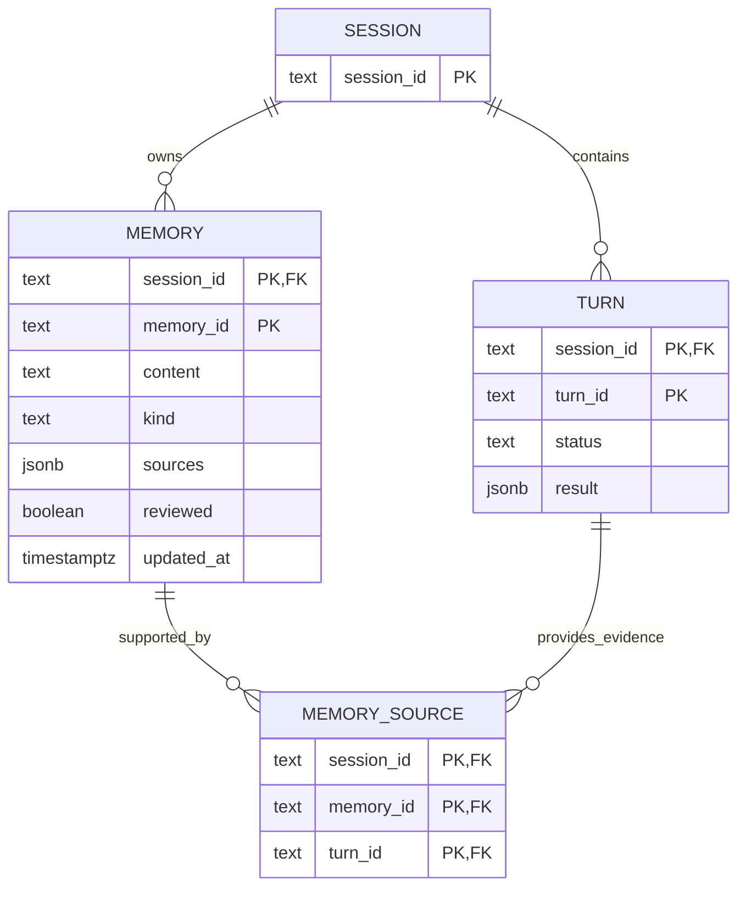

# Phase 03: memory source provenance

Status: deferred, 2026-11-03. Not implemented by the scope-reduction cleanup. Depends on
[Phase 01](memory-01-scope-reduction.md) and [Phase 00](memory-00-contract-hygiene.md).
Prerequisite for [Phase 04](memory-04-draft-learning.md). See the
[program index](memory-program.md).

## Purpose

MEM-5 asks that an approved memory retain links to the Turns it came from, so an
operator can see why it exists. Today a memory holds workspace-file `sources`
only. A learned memory cannot say which conversation produced it.

This phase adds one relationship table and makes saving a memory with its links a
single transaction. It adds no route; the existing `PUT` gains one optional
field.

## Schema

Migration 11, additive, applied after the deployed version is read as usual.



```sql
CREATE TABLE IF NOT EXISTS fleet_lite_memory_sources (
    session_id TEXT NOT NULL,
    memory_id TEXT NOT NULL,
    turn_id TEXT NOT NULL,
    PRIMARY KEY (session_id, memory_id, turn_id),
    FOREIGN KEY (session_id, memory_id)
        REFERENCES fleet_lite_memories(session_id, memory_id) ON DELETE CASCADE,
    FOREIGN KEY (session_id, turn_id)
        REFERENCES fleet_lite_turns(session_id, turn_id)
)
```

Decisions:

- **Composite key.** `(session_id, memory_id, turn_id)` prevents duplicates and
  needs no surrogate ID.
- **Memory deletion cascades.** A link has no meaning without its memory.
- **Turn deletion is `NO ACTION`.** A Turn that backs an adopted memory is not
  independently deletable. Today nothing deletes a Turn row, so this guards a
  future retention job rather than changing current behavior. Session deletion
  cascades both sides and leaves no links.
- **No speculative indexes.** The primary key serves both read directions a
  route needs: links for one memory, and whether one Turn is referenced.
- **No status column.** The Turn's status is read from
  `fleet_lite_turns`, never copied. A copy would drift.

The `sources` JSONB column keeps its workspace-file meaning. Source Turn IDs live
only in the table.

## Store changes

### Save and replace links atomically

`Store.save_memory` currently upserts one row in autocommit. It becomes a single
transaction that also replaces links:

1. Assert the Session row exists.
2. Read and validate every requested Turn: it must exist in this Session and be
   `completed`. Fail before touching memory content.
3. Upsert the memory row.
4. If `source_turn_ids` was supplied, delete existing links for that memory.
5. Insert the new links.

Order matters. Validating before the upsert means the common rejection (a
missing, foreign, or unfinished Turn) never rewrites memory content, so a caller
cannot blank or alter a memory by pairing a valid body with an invalid source
list. Validating inside the transaction means a concurrent `finish_turn` cannot
interleave into an accepted link set: the read and the insert see one snapshot. A
foreign key alone cannot enforce a Turn's status, which is why the check is
explicit.

On any failure, roll back content and links together. A partially applied memory
is worse than a rejected request.

### Semantics of the request field

`MemoryRequest.source_turn_ids: list[str] | None = None`.

| Client sends | Effect |
| --- | --- |
| omits the field | links unchanged |
| `null` | 422; an explicit null is not a preserve signal |
| `[]` | clears all links |
| nonempty list | replaces links with exactly that set |

Distinguish omitted from null with `"source_turn_ids" in model.model_fields_set`.
Reject `null` rather than treating it as omission, because the two produce
different stored states and a client should not guess.

Constraints: at most 20 identifiers, each validated by the existing session-ID
validator, all distinct after validation. Duplicates are a 422, not a silent
dedupe, so a caller learns its input was wrong.

### Read path

- `Store.memories` gains an aggregated source-link read for the returned
  memories. Prefer one query with `LEFT JOIN` and `array_agg`, or a second query
  keyed by the returned IDs, rather than one query per memory.
- Add `Store.memory_sources(session_id, memory_id) -> list[str]` for a single
  memory, ordered for stable output.
- `MemoryRead` gains `source_turn_ids: list[str] = []`.

Ranking is unchanged. `Store.memories` still orders by full-text score; Phase 04
adds its own newest-first query rather than changing this one.

## API changes

`PUT /sessions/{session_id}/memory/{memory_id}` accepts the new optional field
and keeps its current 409 lock behavior, 422 translation, and `MemorySaved`
response. The list route returns `MemoryRead` items with the new field populated.

Example:

```json
{
  "content": "Use uv for Python commands in this project.",
  "kind": "preference",
  "sources": {},
  "source_turn_ids": ["turn_a"],
  "reviewed": true
}
```

Failure mapping:

| Case | Status |
| --- | --- |
| Unknown, foreign, or duplicate Turn ID | 422 |
| Turn exists but is not `completed` | 422 |
| More than 20 IDs | 422 |
| Malformed ID | 422 |
| Turn deleted between validation and commit | 422, transaction rolled back |
| Session lock held by a Turn | 409, unchanged |

Every rejection happens before any write. The route must not create a memory
without its links because a later validation failed.

## Bounded-history caveat

A link preserves identity, not a transcript. Session history is bounded to 200
Turn records by `_APPEND_TURN`, and a Turn `result` does not contain its prompt.
A memory may therefore cite a Turn that is no longer in the stored history.

Consequences the specification accepts:

- Links remain valid and displayable after history ages out.
- Phase 04 must reject a draft request whose selected Turns are no longer
  available with prompt and answer, rather than citing an evicted Turn.
- No archival transcript store is implied.

## Verification

| Case | Expected |
| --- | --- |
| Save with links | Memory and links commit together. |
| Save without the field | Existing links preserved. |
| Save with `[]` | Links cleared, memory updated. |
| Save with duplicates | 422, nothing written. |
| Save with a foreign-Session Turn | 422, nothing written. |
| Save with a non-completed Turn | 422, nothing written. |
| Injected failure between upsert and insert | Memory content unchanged; no links written. |
| Save with a valid body and an invalid Turn ID | Memory content is not rewritten. |
| Delete memory | Its links are gone. |
| Delete a referenced Turn | Refused by the foreign key. |
| Delete a Session | Memories, Turns, and links all gone. |
| Migration on version 10 | Version 11 recorded once; no data touched. |
| Existing clients | Stay valid without the new field. |

## Out of scope

- No archival transcript, no evidence snapshot, no cross-Session links.
- No automatic link creation. Only the operator's save writes links.
- No route that lists memory sources separately; the list response carries them.
- No backfill of links for pre-existing memories.

## Risks

| Risk | Mitigation |
| --- | --- |
| A long-running transaction holds locks during a large save. | The transaction is a handful of statements on keyed rows; no provider call occurs inside it. |
| A client sends `null` and expects preservation. | Rejected explicitly; the contract states omit versus clear. |
| History aging makes a cited Turn unreadable. | Accepted and documented; Phase 04 validates availability before drafting. |
| `array_agg` inflates list responses. | Bound: 20 links per memory, 20 memories per page. |
