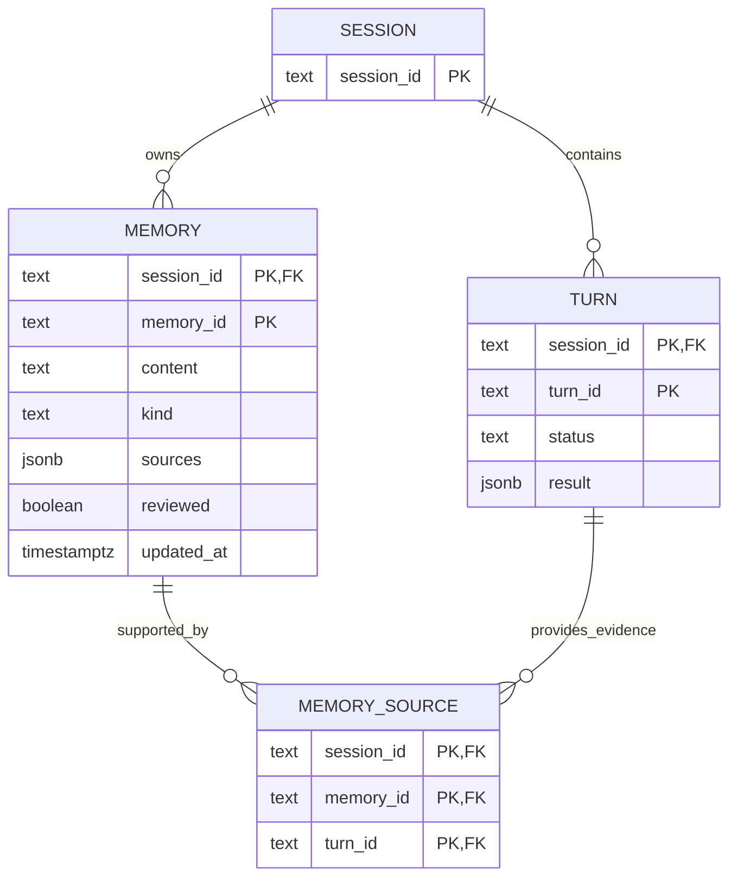

# Memory bootstrap and deliberate learning

Status: deferred, 2026-11-03. Not implemented by the scope-reduction cleanup. This document describes the intended
smaller implementation, not capabilities already delivered by the current diff.
Scope reduction is implemented separately; the additive workflow below remains deferred.

> This document is now the requirement source. Implementation is split into
> independently reviewable phases in the [program index](memory-program.md):
> contract hygiene, scope reduction, setup readiness, schema provenance, and
> draft learning. Where this document and a phase differ, the phase is more
> specific; the requirements below remain authoritative.

## User value and requirements

Fleet already has Session-scoped memories, reviewed-memory retrieval, CRUD,
per-Turn learned notes, PostgreSQL migrations, and setup probes. The missing
value is an accessible, verified setup path and deliberate consolidation across
selected conversations. More memory infrastructure is not itself a benefit.

| ID | Use case | Acceptance criterion |
| --- | --- | --- |
| MEM-1 | Prepare the configured memory database | Existing additive initialization succeeds twice without losing data. |
| MEM-2 | Know whether memory storage is usable | Readiness identifies database/schema, version, and required access without models or Daytona. |
| MEM-3 | Inspect, correct, and forget memories | Existing FastAPI memory operations remain usable and expose typed results. |
| MEM-4 | Learn from selected completed work | One explicit operation returns useful, bounded proposals with supporting Turn references; empty output is valid. |
| MEM-5 | Control adoption and understand sources | Only an operator saves proposals; approved memories retain validated source links. |

First-version scope is one selected Session, including its source Turns and
destination memories. Dreamer means a workflow inspired by distillation and
consolidation; it does not promise parity with Databricks' proprietary pipeline.
Databricks is not required. PostgreSQL may still be hosted on Lakebase.

## Durable schema and boundaries

Reuse [Store](../../src/fleet_rlm/store.py), its pool, numbered migrations, and
transactions. Pydantic models describe application/API data; they do not replace
database foreign keys or transactions. Do not introduce an ORM or another
migration framework.



This is a relevant-field view of existing tables plus one proposed table.

| Table | Decision and rationale |
| --- | --- |
| `fleet_lite_sessions` | Reuse existing identity, bounded history, and summary. No new Session concept. |
| `fleet_lite_turns` | Reuse composite identity and successful `completed` status. No duplicated conversation ledger. |
| `fleet_lite_memories` | Retain `(session_id, memory_id)` key, content, kind, workspace-file `sources`, reviewed flag, timestamp, and existing full-text index. |
| `fleet_lite_memory_sources` | Add `(session_id, memory_id, turn_id)` primary key, foreign key to memories, and foreign key to Turns. Permanent provenance is the specific reason for this addition. |

All new source columns are non-null text, matching existing identifiers. A source
link must reference a completed Turn in the same Session. Validate completion in
the Store transaction; a foreign key alone cannot enforce a Turn's status.
Delete links with their memory. Use PostgreSQL's default NO ACTION behavior for
independent deletion of referenced Turns. Session deletion cascades through its
memories and Turns, leaving no links. Save memory and replace explicit source
links atomically. The primary key prevents duplicate links; add no speculative
indexes beyond keys needed for these operations.

Keep the existing `sources` JSONB field's workspace-file meaning. Source Turn
IDs live in the relationship table, not arbitrary JSON keys. A manually entered
memory can have zero source Turns.

Source links preserve identity, not an immutable transcript. A Turn's completion
state lives in `fleet_lite_turns`, but its prompt and answer live in the Session's
bounded `turns` array; `fleet_lite_turns.result` holds the answer and outcome, not
the prompt. Drafting must therefore join both and reject selected Turns whose
prompt/answer is no longer available. Archival transcripts and evidence snapshots
are outside this version.

Apply the new table as migration 11 after checking the actual deployed schema
version. Preserve applied migrations, including migrations 9 and 10 observed in
live environments: removing an applied entry makes `Store.initialize` refuse a
database whose recorded version is newer than the code. No table drops, version
downgrade, or data conversion is authorized by this specification.

## FastAPI and Pydantic v2 contracts

Extend the existing [schemas](../../src/fleet_rlm/api/schemas.py) and
[memory routes](../../src/fleet_rlm/api/routes/sessions.py). Keep the Session ID
in the route. Reuse existing identifier validation and memory kind vocabulary.

| Model | Contract |
| --- | --- |
| `MemoryRequest` | Existing content (1–10,000 characters, nonblank), kind, workspace sources, and reviewed flag; add optional `source_turn_ids`. Omission preserves links; an explicit list replaces them; `[]` clears them. Explicit null is invalid. |
| `MemoryRead` | Memory ID, content, typed kind, workspace sources, reviewed flag, source Turn IDs, and timezone-aware `updated_at`. An `AwareDatetime` serializes as `...Z`; the Store currently returns `updated_at.isoformat()`, so this is a client-visible normalization, not a field rename. |
| `MemoryDraftRequest` | `turn_ids`: 1–20 distinct validated IDs in this Session. No actor/provider selection or model override. |
| `MemoryProposal` | Content, kind, 1–20 supporting `source_turn_ids`, rationale, and optional `target_memory_id` for a proposed correction/merge. |
| `MemoryConflict` | `memory_ids`, `source_turn_ids`, and `reason`; references must belong to the supplied context. The model emits conflicts and the host adds structural ones (duplicate content, duplicate target, invalid references); the merged list records uncertainty for review, not an automatic resolution. |
| `MemoryDraft` | `proposals` and `conflicts`; conflicts identify involved memories/Turns and describe the uncertainty. Empty arrays are valid. No persisted draft/job identity. |

Use `BaseModel`, `ConfigDict(extra="forbid")` on requests, `Field`, shared typed
`Literal` values, `AwareDatetime`, `model_validate`, and `model_dump`. Use native
constraints before custom validators. Avoid parallel dataclass/dictionary/DTO
representations of the same contract. Keep Store SQL independent of FastAPI.
[Pydantic models](https://docs.pydantic.dev/latest/concepts/models/)

Replace the memory-list response's `list[dict[str, Any]]` with
`list[MemoryRead]`, preserving its `memories` envelope and existing field names.
Add exactly one HTTP operation:

`POST /sessions/{session_id}/memory/drafts` → `200 MemoryDraft`

Use FastAPI dependencies for Store/settings and typed responses for validation,
serialization, and generated OpenAPI. Blocking model/SQL calls run in a normal
`def` handler/threadpool. This operation must not acquire a sandbox merely to
access memory. Use `StoreDep` and `Settings`, not `Runtime`: resolving a runtime
acquires a storage lease, advances the sandbox ownership epoch, may reconcile
provider resources, and starts a lease monitor. It also takes no Session lock,
because it writes nothing. Reuse existing mutation controls for approval writes.
[FastAPI response models](https://fastapi.tiangolo.com/tutorial/response-model/)

Example draft request:

```json
{"turn_ids": ["turn_a", "turn_b"]}
```

Example response:

```json
{
  "proposals": [{
    "content": "Use uv for Python commands in this project.",
    "kind": "preference",
    "source_turn_ids": ["turn_a"],
    "rationale": "The user explicitly selected this convention.",
    "target_memory_id": null
  }],
  "conflicts": []
}
```

After review, use the existing
`PUT /sessions/{session_id}/memory/{memory_id}`:

```json
{
  "content": "Use uv for Python commands in this project.",
  "kind": "preference",
  "sources": {},
  "source_turn_ids": ["turn_a"],
  "reviewed": true
}
```

This is an explicit operator assertion of review, not a new authentication
mechanism. Preserve loopback defaults and the secured boundary required for
external access. Do not add another operator token system.

Invalid, foreign-Session, unavailable, non-completed, or oversized source input
returns 422 before inference. Existing mutation conflicts remain 409. Missing
storage/model availability returns a sanitized 503; model timeout returns 504.
Malformed model output yields 503 and no proposals are applied. Preserve existing
HTTP behavior for unrelated routes.

## Learning workflow and reuse decisions

1. Read selected available prompt/answer pairs and up to 20 existing memories
   from the same Session. Bound transcript input to 40,000 characters and total
   included memory content to 20,000; reject excess rather than silently truncate
   evidence. If more memories exist, include the 20 most recently updated;
   proposals are scoped to that subset and must not claim exhaustive consolidation.
   Never drop memories to fit the bound: a silent subset would change
   consolidation scope without telling the operator. These are first-version
   cost/context bounds, not quality claims.
2. Run one native `dspy.Predict` with typed output under scoped `dspy.context`
   and the existing configured root LM. Bound each model call to 60 seconds with
   `LM.copy(timeout=60, num_retries=0)`. DSPy's native adapter fallback can issue
   one further call for a malformed response, so this is a per-call bound, not a
   hard wall-clock cap. Reuse model construction, tracing, and serialization. No
   custom retry loop, delegated agents, provider adapter, or separate serving
   Turn.
3. Propose at most 10 durable memories. Prefer explicit facts, preferences,
   corrections, and repeatable procedures. Treat source text as untrusted data;
   do not infer unsupported preferences or turn transient results into facts.
4. Validate references against the supplied source set and existing target
   memories. Return proposed changes and unresolved conflicts without DB writes.
   A model's rationale does not prove that its proposal is correct.
5. The operator reviews and edits proposals, then saves each chosen memory with
   the existing PUT. Corrections update the chosen memory ID; there is no
   automatic merge/delete. Existing reviewed-memory retrieval supplies approved
   facts to subsequent Turns in that Session.

The added value over `learned_skill_note` is explicit consolidation of selected
completed work against existing memories. If a controlled example cannot show
that value, defer distillation rather than expanding the framework.

| Current area | Assessment | Requirement/rationale |
| --- | --- | --- |
| Store, migrations, existing memory CRUD/search | Reuse | MEM-1/3/5; already own persistence and memory behavior. |
| Database identity/privilege setup improvements | Keep only justified checks | MEM-2; separate these from managed-provider readiness and avoid probing models. |
| Typed memory responses and source-link writes | Necessary change | MEM-3/5; clear contracts and permanent provenance. |
| One DSPy draft operation | Necessary change | MEM-4; controlled batch learning with review. |
| Managed recall, Jev selection, Turn receipts, Session bindings | Removal candidates | Not needed for one-Session local learning; preserve pre-existing recall behavior. |
| Managed exporter/outbox and pipeline ledger/leases | Removal candidates in application code | No provider export or background run in this spec. Retain deployed schema history/data. |
| Managed operator API, CLI/TUI pipeline/status surfaces | Removal candidates | Duplicated surfaces without an approved use case here. |
| Managed-memory verifier scripts/tests and provider runbooks | Defer/archive assessment | Preserve historical evidence; do not treat provider canaries as acceptance of this workflow. |
| MLflow defaults, general setup/auth changes, evaluation edits | Review independently | Adjacent changes are not automatically prerequisites. Keep unrelated user work intact. |
| New ORM, vector DB, job scheduler, provider abstraction | Do not add | Existing dependencies cover the agreed requirements. |

Every retained or proposed implementation hunk and test must map to a requirement,
user benefit, existing capability considered, actual gap, and acceptance evidence.
Record that mapping in the implementation review, not repetitive source comments.

## Acceptance and implementation checkpoint

- MEM-1/2: fresh/repeated initialization, old data preserved, future-version
  rejection, correct target reporting, and actionable role/connection failures.
- MEM-3/5: old requests still work; typed lists serialize timestamps; omitted
  source links preserve, explicit lists replace, empty lists clear; duplicates,
  foreign/missing/non-completed Turns fail; failed transactions roll back both
  content and links; deletion respects relational integrity.
- MEM-4: no-op, useful fact, duplicate, contradiction, untrusted instructions,
  bad references, oversized/unavailable history, timeout, and malformed output.
  No draft request writes memories or provisions Daytona.
- Adoption: generate a proposal, approve through PUT, and confirm existing
  reviewed-memory input contains it in the same Session. Unapproved drafts do
  not affect context.
- Use offline fakes for ordinary CI. One separately authorized model/database
  canary must show useful learning; successful inference alone is insufficient.
- During implementation run focused pytest, `make check`, and existing OpenAPI
  generation/check tooling. Do not introduce tests that merely mirror field declarations.

The keep/remove map is recorded by [Phase 01](memory-01-scope-reduction.md).
Scope reduction restores the existing Databricks SDK authentication behavior;
it introduces no replacement identity setting or personal profile default.
Review this specification separately before implementing any additive phase.
No new CRUD surface, cross-Session memory, automatic approval, scheduled
learning, transcript archive, Databricks integration, or deployment is implied.
