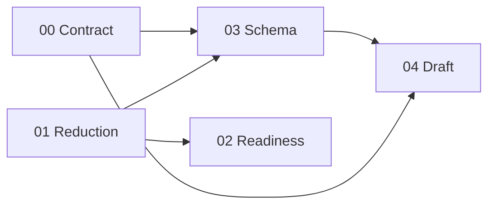

# Memory program: phased specifications

Status: scope reduction implemented; additive phases deferred, 2026-11-03. This index replaces a single
bootstrap-and-learning specification with five independently reviewable phases.
Except for completed scope reduction, it describes intended behavior rather
than capabilities already delivered by the current worktree.

## Why this is split

The managed-memory experiment has been removed from the runtime. Existing
Session-scoped local memory remains. The specifications preserve possible
future work; they do not authorize implementing it during cleanup.

There is also contract debt that the small workflow would otherwise build on. A
memory response model is still `list[dict[str, Any]]`, a memory kind is a regex
instead of an enum, memory content accepts whitespace that the route then
rejects, and one timestamp is a `str` while its sibling is a `datetime`. Fixing
those after adding `MemoryRead` means doing the work twice or shipping three
representations of the same contract.

The phases below separate contract hygiene, removal, and each additive step.

## Requirement map

Requirements are unchanged from the original
[bootstrap-and-learning specification](memory-bootstrap-and-learning.md).

| ID | Use case | Phase |
| --- | --- | --- |
| MEM-1 | Prepare the configured memory database | [02 Setup readiness](memory-02-setup-readiness.md) |
| MEM-2 | Know whether memory storage is usable | [02 Setup readiness](memory-02-setup-readiness.md) |
| MEM-3 | Inspect, correct, and forget memories | [00 Contract hygiene](memory-00-contract-hygiene.md), [03 Schema and provenance](memory-03-schema-provenance.md) |
| MEM-4 | Learn from selected completed work | [04 Draft learning](memory-04-draft-learning.md) |
| MEM-5 | Control adoption and understand sources | [03 Schema and provenance](memory-03-schema-provenance.md), [04 Draft learning](memory-04-draft-learning.md) |

Phase [01 Scope reduction](memory-01-scope-reduction.md) establishes no
requirement. It removes code that does not serve one, which the project
guidelines require before new abstractions are added.

## Phases

| Phase | File | Changes |
| --- | --- | --- |
| 00 | [Contract hygiene](memory-00-contract-hygiene.md) | Typed memory list, enum kind, nonblank content, one timestamp convention. |
| 01 | [Scope reduction](memory-01-scope-reduction.md) | Delete unrequired managed-memory surfaces; retain applied migrations. |
| 02 | [Setup readiness](memory-02-setup-readiness.md) | Read-only database probe and a database-only initialize command. |
| 03 | [Schema and provenance](memory-03-schema-provenance.md) | Migration 11 source-link table and atomic save-and-link transaction. |
| 04 | [Draft learning](memory-04-draft-learning.md) | One native `dspy.Predict` draft operation and one route. |

P0 and P1 are independent of each other. P1 must land before P2 and P3, because
both edit code that P1 deletes. P4 needs P0 for the models it reuses and P3 for
the links it proposes against.

## Decision log

| # | Decision | Resolution |
| --- | --- | --- |
| D1 | Lakebase OAuth identity after removal | Restore existing Databricks SDK authentication. No new profile setting, personal default, or coupling to the MLflow tracking URI is introduced. Deployment identities stay in private SDK/environment configuration. |
| D2 | The 20 newest memories exceed 20,000 characters | Reject with 422 before inference, reporting counts only and never echoing content. Select the 20 most recently updated first, then measure, so refusal is deterministic. Never drop memories to fit: a silent subset would change consolidation scope without telling the operator. |
| D3 | Conflicts and invalid model references | The model emits conflicts; the host adds duplicate-content and duplicate-`target_memory_id` conflicts, merges, and dedupes. A well-formed proposal whose references are unknown, foreign, or non-completed is dropped and reported as a conflict. Only unparseable or shape-invalid output is 503. |
| D4 | Model time bound | 60 seconds per model call through `LM.copy(timeout=60, num_retries=0)`. DSPy's native adapter fallback can issue one further call, so the contract says "per model call", not "hard wall". A provider timeout maps to 504. No thread abandonment and no custom retry loop. |
| D5 | Migration numbering | The source-link table is migration 11. Migrations 9 and 10 stay in `_SCHEMA_MIGRATIONS` even after the managed code that motivated them is deleted, because `Store.initialize` refuses to start against a database whose recorded version is newer than the code. |

## Facts the specifications depend on

These were verified in the worktree, not assumed.

- `fleet_lite_memories` already has `(session_id, memory_id)`, content, kind,
  `sources` JSONB, `reviewed`, `updated_at`, and the migration-7 full-text index
  (`src/fleet_rlm/store.py`).
- `Store.initialize` applies numbered migrations under an advisory lock and
  refuses a database version newer than `SCHEMA_VERSION`
  (`src/fleet_rlm/store.py`).
- A Turn's prompt and answer live in `fleet_lite_sessions.turns`, bounded to 200
  entries by `_APPEND_TURN`; `fleet_lite_turns.result` holds the answer and
  outcome but not the prompt. Draft input must join both.
- `completed` is terminal: `Store.finish_turn` skips it and
  `Store.fail_interrupted_turns` only rewrites `running` rows.
- `Store.memories` ranks by full-text score, so a draft that needs the 20 most
  recently updated needs a separate query rather than a reused one.
- `Runtime` is not a read-only dependency. `SessionRuntimeRegistry.get` builds a
  runtime that acquires a storage lease, advances the sandbox ownership epoch,
  may reconcile provider resources, and starts a lease monitor. A route that only
  reads memory or calls a model must use `StoreDep` and `Settings` instead.
- Installed DSPy (3.4.1) parses a nested Pydantic output through `ChatAdapter`
  and raises `AdapterParseError` for an out-of-vocabulary `Literal`. Verified
  offline; no live model call was made.
- `StringConstraints(strip_whitespace=True, min_length=1)` rejects whitespace-only
  content, and a shared `Literal` emits an OpenAPI `enum` where `pattern=`
  currently emits `type: string` plus `pattern`.

## Gates between phases

Each phase is reviewed and merged on its own. No phase authorizes the next.

| Phase | Gate |
| --- | --- |
| 00 | Focused API tests, `make check`, and a reviewed `openapi.yaml` diff. |
| 01 | Existing tests pass with managed-memory tests deleted and unrelated assertions updated; migrations 9 and 10 still present; no data dropped. |
| 02 | Repeated initialization preserves old rows; future-version refusal; actionable privilege failure with models and Daytona absent. |
| 03 | Link transaction rollback, foreign and non-completed rejection, cascade behavior, old requests unchanged. |
| 04 | Offline fake-model coverage for no-op, duplicate, contradiction, untrusted instructions, bad references, oversized history, timeout, malformed output; no write and no sandbox on any draft path. |

Ordinary CI stays independent of live services. One separately authorized
database and model canary must show useful learning; successful inference alone
is not acceptance.

## Non-goals

No new CRUD surface, cross-Session memory, automatic approval, scheduled
learning, transcript archive, Databricks pipeline integration, ORM, vector store,
job scheduler, or provider abstraction is implied by any phase. No phase
authorizes a commit, push, or deployment.
